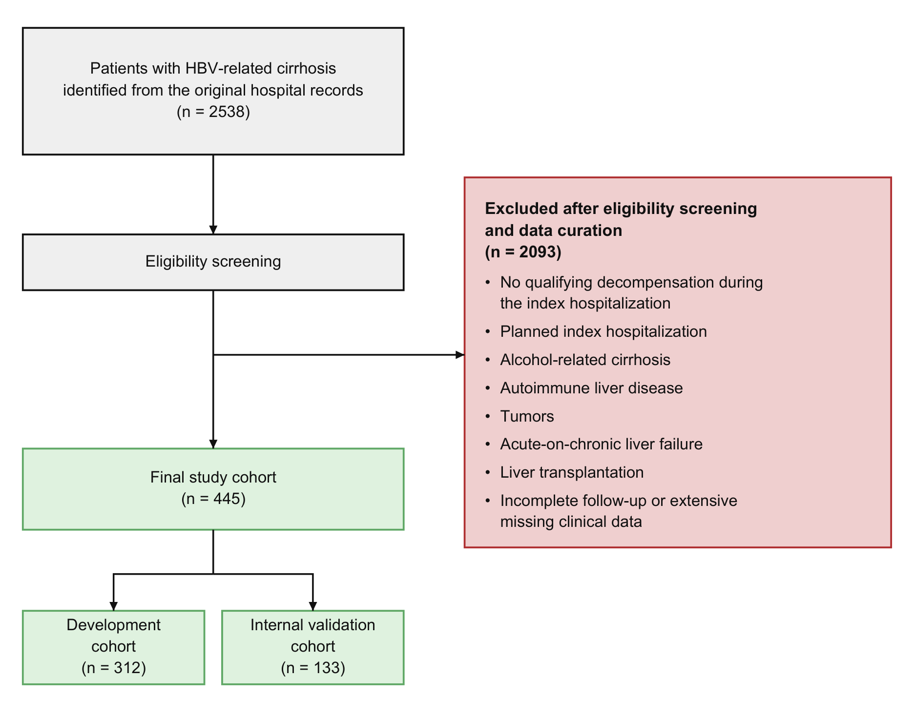
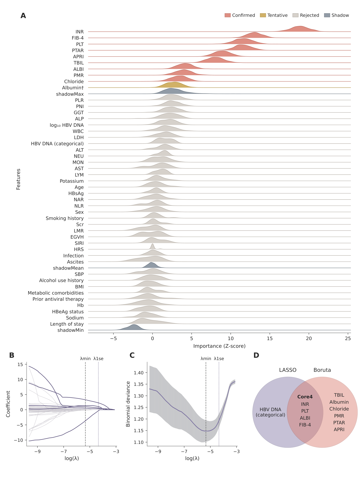
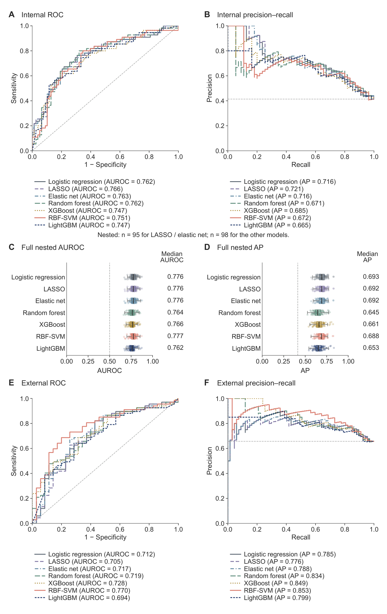
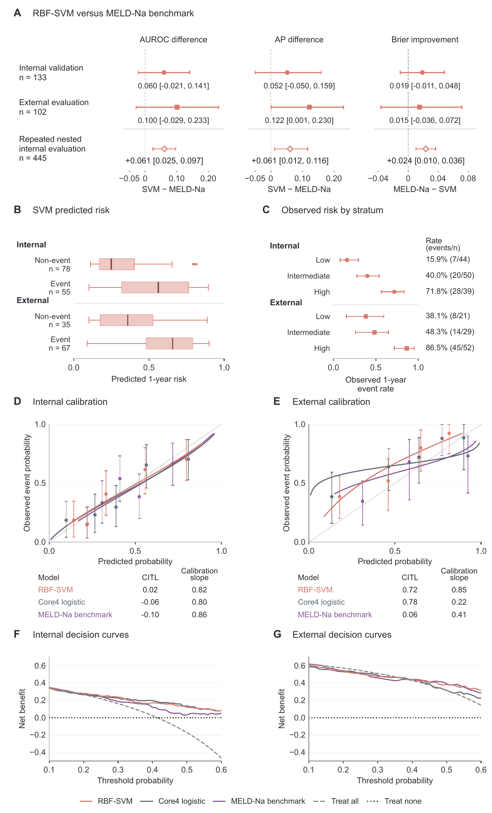
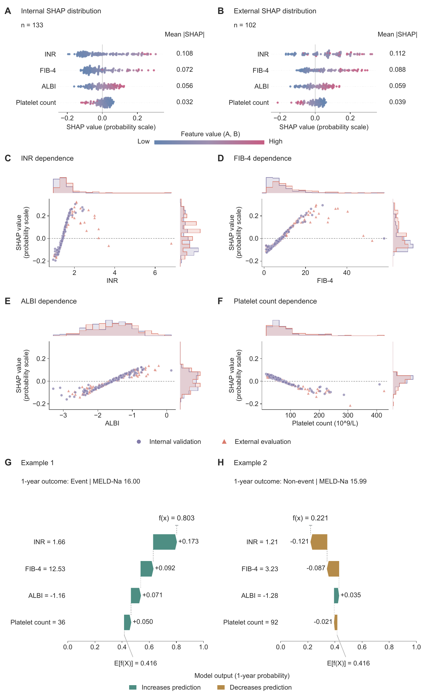
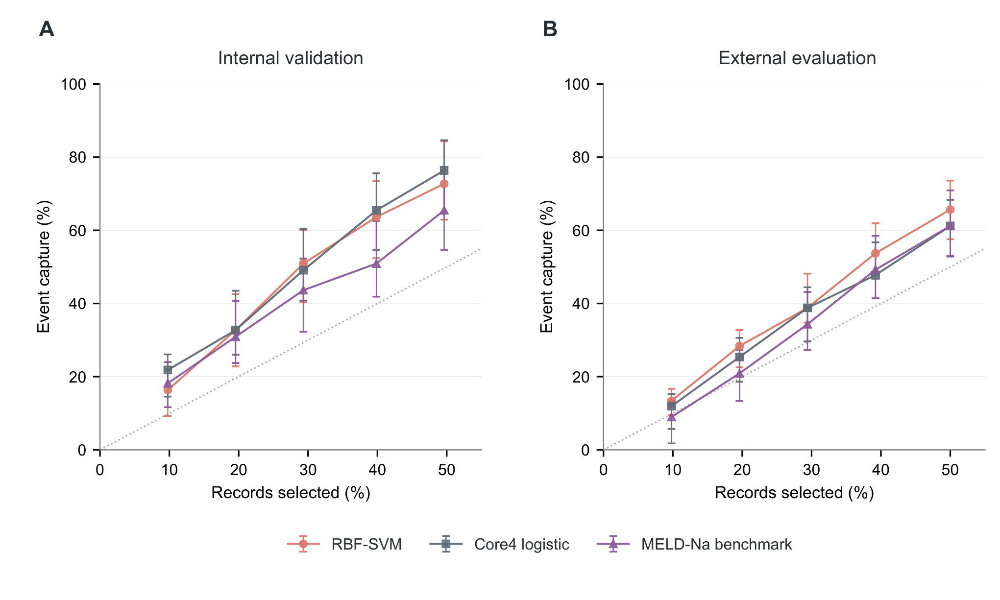
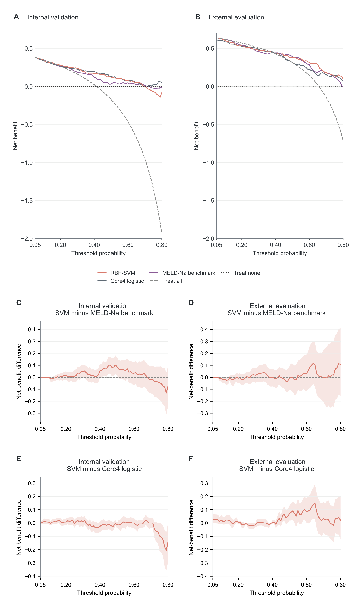

# HBV相关失代偿期肝硬化1年非计划性再入院预测研究

中文总稿（含摘要、正文及全部图表）  ·  2026年10月2日

## 摘要

背景与目的：失代偿期肝硬化患者出院后仍可因新的或复发性失代偿而再次住院，但现有预测研究主要关注短期风险。针对乙型肝炎病毒（HBV）相关患者，较长期再入院风险的预测证据仍有限。本研究旨在利用常规临床信息，建立并评价该人群出院后1年失代偿相关非计划再入院预测模型。

方法：本单中心回顾性研究纳入445例患者，分为开发队列（312例）和内部验证队列（133例），另基于MIMIC-IV数据库开展外部评价。采用LASSO与Boruta筛选预测变量，建立7种候选模型，并结合内部验证、完整嵌套重采样及外部评价综合确定主模型。以MELD-Na为临床基准，评价模型的区分度、校准及风险分层表现。

结果：国内队列中185例（41.6%）发生目标再入院。整合INR、血小板计数、ALBI和FIB-4的径向基核支持向量机（RBF-SVM）经综合评价确定为主模型，在内部验证中的受试者工作特征曲线下面积（AUROC）为0.751（95%置信区间：0.660–0.832）；外部评价进一步支持了其区分能力，AUROC为0.770（0.640–0.871）。与MELD-Na相比，模型在两个队列中的AUROC和Brier评分点估计均有改善。这种预测信息也体现于风险分层：沿用开发队列确定的界值，内外部队列的观察事件率均随风险层级递增。

结论：本研究建立了基于四项常规临床指标的RBF-SVM模型，其对HBV相关失代偿期肝硬化患者出院后1年失代偿相关非计划再入院的预测价值获得了内外部评价支持。该模型可为出院后的个体风险评估与随访优先级判断提供参考。

## 引言

肝硬化进入失代偿阶段后，患者可反复发生腹水、静脉曲张出血、肝性脑病及其他失代偿事件，并面临较高的再入院和死亡风险。近年来，失代偿后的疾病自然史被进一步认识为动态过程。Baveno VII对“进一步失代偿（further decompensation）”和“再代偿（recompensation）”作出界定，以描述失代偿后的不同临床轨迹：部分患者在病因得到有效控制后可出现失代偿表现消退和肝功能持续改善，而另一些患者仍会发生新的或复发性失代偿事件[1]。HBV相关队列研究进一步表明，部分患者在持续抗病毒治疗后仍可能发生失代偿事件[2]。因此，识别失代偿后仍处于较高再次失代偿风险的患者，是HBV相关失代偿期肝硬化长期管理中的重要任务。

新的或复发性失代偿事件常导致非计划再入院，构成失代偿后疾病负担的重要表现。Pompili等对急性失代偿肝硬化患者进行1年随访发现，再入院的累积发生率估计在30天、90天和1年分别为20%、39%和63%，肝性脑病和腹水是常见再入院原因。尽管该研究描述了较长期的再入院情况，其预测分析仍聚焦于30天早期再入院[3]。Hu等在纳入2170例肝硬化住院患者的多中心队列中发现，包括支持向量机和随机森林在内的多种模型对30天和90天再入院的区分能力总体有限，且与MELD-Na相近[4]。

MELD及MELD-Na主要用于评估肝病严重程度和死亡风险[5]。针对再入院风险，研究者已尝试整合常规临床信息建立专门的预测工具。Sánchez-Torrijos等开发并验证了预测7天、30天和90天非计划再入院的REACT评分[6]；Yang等建立了30天再入院的随机森林模型，并开展外部验证及与传统评分的比较[7]。尽管HBV感染是我国肝硬化的主要病因[8]，针对该人群一年失代偿相关再入院的预测证据仍较有限。

基于此，本研究旨在利用常规临床信息，建立并评价HBV相关失代偿期肝硬化患者出院后1年失代偿相关非计划再入院的预测模型。我们比较多种建模方法，开展内部验证和基于MIMIC-IV的外部评价，并考察模型相较MELD-Na的补充预测价值。通过风险分层与个体预测解释，进一步探索其在出院后风险评估中的潜在用途。

## 资料与方法

### 研究人群

本研究为单中心回顾性队列研究，纳入2012年1月至2023年12月期间于重庆医科大学附属第一医院住院的HBV相关失代偿期肝硬化患者。研究以出院为预测起点，评估患者在随后1年内发生非计划性失代偿相关再入院的风险，并建立及验证相应预测模型。

HBV相关肝硬化依据《慢性乙型肝炎防治指南（2022年版）》[9]进行判定，并结合HBV血清学或既往慢性HBV感染史及肝硬化临床或影像学证据，同时排除其他主要肝病病因。入选标准及具体筛选流程见图1。主要排除标准包括计划性住院、酒精相关肝硬化、自身免疫性肝病、肿瘤、肝移植，以及随访不完整或临床资料严重缺失；对于慢加急性肝衰竭（ACLF），采用《慢加急性肝衰竭诊治指南（2025年版）》[10]作为统一标准，对研究期间的既往病历进行回顾性复核，符合ACLF诊断者予以排除。

最终纳入445例患者，并按结局分层以70:30划分为开发队列（n=312）和内部验证队列（n=133）。本研究遵循《赫尔辛基宣言》，并经重庆医科大学附属第一医院伦理委员会批准（2025-925-01）。

### 结局

主要结局定义为出院后1年内因静脉曲张出血、腹水、肝性脑病、肝肾综合征（hepatorenal syndrome, HRS）或自发性细菌性腹膜炎所致的非计划再入院。因计划性治疗、检查或其他择期安排导致的再入院不计为结局。

患者随访至出院后1年，通过医院住院记录、门诊记录及电话随访确认再入院事件。随访不完整者，以及在1年随访期内死亡且此前未发生目标再入院事件者，不纳入最终二分类分析。

### 数据收集及缺失值处理

为开发1年再入院预测模型，我们从医院电子病历中提取46个候选预测变量（补充表S3），包括人口学及生活方式特征、HBV相关血清学和病毒学指标、肝硬化相关临床特征，以及常规实验室检查和派生肝病指标。用于模型构建及临床评分比较的实验室指标采用最接近入院时间的可用检测值，以入院时及入院早期检测结果为主。原始数据整体完整性较高，仅少数候选变量存在少量缺失，具体数据可用性及缺失情况见补充表S3。

国内队列的少量缺失数据在开发队列和内部验证队列划分后采用链式方程多重插补处理。插补模型仅基于开发队列估计，内部验证队列不参与插补参数估计；结局变量不进行插补，也不作为插补预测变量。共生成5套完成数据，并采用预先固定的完成数据集进行后续模型开发和评价。派生指标在基础变量处理完成后重新计算。派生指标均依据既有定义由基础临床或实验室变量计算，具体公式及变量定义见补充表S3。

### 外部队列

外部队列来源于MIMIC-IV数据库（version 3.1）[11,12]，按照与国内队列一致的纳入和排除标准筛选符合条件的住院记录。外部队列以符合条件的住院记录为分析单位，同一患者可贡献多次符合条件的住院记录，各次住院均独立定义其出院后的1年风险窗口。外部模型输入均采用实际观测值，不进行统计插补。

### 特征筛选

分类变量按照预先定义的临床类别进行编码，连续变量保留其数值形式。特征筛选仅在开发队列中进行。基于预先定义的候选预测变量，分别采用最小绝对收缩与选择算子（LASSO）回归和Boruta算法进行互补筛选，并将两种方法共同保留的变量定义为主要预测特征集合。LASSO采用十折交叉验证确定惩罚参数，并使用λ₁se对应的变量集合；Boruta采用TentativeRoughFix处理暂定变量。筛选后采用Spearman相关分析和方差膨胀因子评估变量间相关性及多重共线性（补充表S3C）。为评价特征选择对样本扰动的敏感性，在重复嵌套重采样中于每个外层训练集中重新执行缺失数据处理、LASSO和Boruta筛选，并记录各变量的选择频率及所得交集与原始特征集合的重叠程度。进一步开展不同变量表示及特征消融分析，以评价不同变量表示方式和特征组合对模型性能的影响（补充表S6）。

### 模型选择与比较

为比较不同建模方法的预测表现，基于筛选后获得的共同预测变量集合建立7种候选模型，包括Logistic回归、LASSO、弹性网络、随机森林、XGBoost、LightGBM和径向基核支持向量机（RBF-SVM）。需要调参的模型均仅在开发队列中完成超参数优化，无惩罚Logistic回归不进行参数搜索（补充表S4）。

模型性能采用受试者工作特征曲线下面积（AUROC）、平均精确率（AP）、Brier评分、校准截距（CITL）和校准斜率进行评价。为评价完整建模流程在数据扰动下的稳定性，进一步进行100次按结局分层的重复嵌套重采样。每次外层均将国内队列按70:30划分为训练集和测试集，并仅在外层训练集中重新完成缺失数据处理、LASSO和Boruta特征筛选、候选模型调参及拟合，随后在对应外层测试集中评价模型性能。外层测试数据不参与插补参数估计、特征筛选或超参数选择。各模型在重复嵌套重采样中的AUROC、AP和Brier评分以中位数及四分位距概括，用于描述完整建模流程的内部泛化表现及其变异。

候选模型首先在固定内部验证队列及重复嵌套重采样中进行评价，随后将开发阶段确定的模型直接应用于外部队列，不进行重新训练、参数调整或重新校准。主模型的确定综合考虑AUROC、平均精确率（AP）、Brier评分、校准截距（CITL）、校准斜率以及不同数据集中的表现一致性，不采用单一指标排序或预设加权评分。确定的主模型用于后续MELD-Na临床基准比较、风险分层、决策曲线分析及模型可解释性分析。

### 临床基准、校准与决策曲线分析

在候选模型评价基础上，进一步开展与传统临床基准的比较。临床基准包括基于筛选后预测变量建立的Logistic回归模型及MELD-Na单预测变量Logistic基准模型；MELD-Na基准模型在开发队列中建立，并直接应用于内部验证和外部队列进行评价。在重复嵌套内部评价中，基于两模型共同获得的外层测试预测进行患者级聚合，并采用配对方法比较AUROC、AP和Brier评分。

根据开发队列预测风险分布确定风险分层切点，并将其固定应用于内部验证和外部评价队列，以比较不同风险层的患者覆盖、事件捕获及遗漏事件。模型校准采用校准截距、校准斜率和校准曲线进行评价[13]。决策曲线分析用于比较不同阈值概率下各模型的净获益[14]，并进一步采用同等选取比例分析比较不同模型对观察事件的捕获能力。

### 模型可解释性分析

采用SHAP（SHapley Additive exPlanations）方法解释主模型的预测输出[15]。以开发队列全部记录作为共同经验参考背景，采用exact Kernel SHAP计算内部验证队列和外部评价队列中各预测变量对正类预测概率的贡献。全局重要性以平均绝对SHAP值表示，并结合依赖图展示特征取值与模型预测贡献之间的关系；局部SHAP用于分解个体预测结果。

在个体层面，从内部验证队列中选取说明性病例进行局部SHAP分析，以展示各特征对个体模型预测输出的贡献。SHAP值反映特征对模型预测的归因，不代表独立病因效应或因果关系。

### 统计分析

连续变量以中位数和四分位距表示，组间比较采用Mann–Whitney U检验；分类变量以频数和百分比表示，采用χ²检验或Fisher确切概率法进行比较。标准化均数差（SMD）用于描述不同队列间的病例构成差异。

内部分析采用患者水平bootstrap估计不确定性；外部分析考虑同一患者可贡献多次住院记录，采用以患者为聚类单位的cluster bootstrap。模型间性能差异采用配对分析，并报告95%置信区间。所有检验均为双侧检验，P&lt;0.05认为差异具有统计学意义。统计分析主要使用R软件（版本4.5.1）和Python（版本3.12.14）完成。

## 结果

### 研究人群与基线特征

在初步识别的2,538例HBV相关肝硬化患者中，经筛选最终纳入445例，其中312例进入开发队列，133例进入内部验证队列（图1）。共有185例（41.6%）在出院后1年内发生非计划性失代偿相关再入院。国内队列总体人口学、临床及实验室特征见表1，开发队列和内部验证队列按结局分层的详细特征见补充表S1。

在开发队列和内部验证队列中，再入院患者均表现出较低的白蛋白和血小板水平，以及较高的总胆红素和INR；MELD-Na、ALBI和FIB-4亦均存在显著差异。相比之下，性别、HBsAg水平、HBeAg/anti-HBe状态，以及腹水、静脉曲张出血、自发性细菌性腹膜炎和感染等临床特征在两队列中均未观察到显著差异。开发队列中，再入院患者的HBV DNA水平较高，且HBV DNA分层分布存在组间差异；上述差异在内部验证队列中未重复观察到。其他变量的完整比较见补充表S1。

与国内队列相比，外部队列在年龄、INR、肌酐、血钠、FIB-4和MELD-Na等指标上存在病例构成差异，而白蛋白、血小板和ALBI总体较为接近。外部队列FIB-4和MELD-Na中位数分别为9.65和18.43，国内队列相应值为5.76和12.47。完整外部特征及国内外病例构成比较见补充表S2。

### 特征选择

在开发队列中采用LASSO回归和Boruta算法进行互补特征筛选（图2）。LASSO在λ₁se下保留5个变量，Boruta经TentativeRoughFix后保留10个变量。

两种方法共同识别出INR、PLT、ALBI和FIB-4，并将其定义为Core4。HBV DNA分类被LASSO保留，但未被Boruta保留，因此未进入最终交集。Core4变量间最大绝对Spearman相关系数为0.74，各变量VIF为1.30–1.49，未见明显多重共线性。在100次完整重复嵌套重采样中，INR、ALBI、PLT和FIB-4的选择频率分别为100%、85%、67%和46%。所得交集与原Core4的Jaccard相似度中位数为0.75（四分位距0.50–1.00），提示不同特征的选择稳定性存在差异（补充表S3B、C）。

变量表示和特征消融分析显示，结果对特征表示方式存在一定敏感性，但未识别出在内部与外部评价中均持续优于原Core4的替代方案。原始变量表示在内部评价中维持了相近的预测性能，但其外部表现下降；派生指标表示亦未在两个队列中形成一致优势。Core4消融后各模型性能变化的方向和幅度随队列及评价指标而异，未显示某一单个特征可被稳定删除或由其他特征完全替代。详细结果见补充表S6A、B。

### 候选模型性能与主模型选择

在固定内部验证队列中，各候选模型总体表现接近，未观察到单一算法在所有评价指标上持续占优。LASSO的AUROC、AP和Brier评分点估计分别为0.766、0.721和0.192，RBF-SVM相应为0.751、0.672和0.199，LightGBM为0.747、0.665和0.201；RBF-SVM的校准截距最接近0。

在100次完整重复嵌套重采样中，各候选模型的性能分布总体重叠，未观察到单一算法在内部评价中持续占优。Logistic回归、LASSO、弹性网络和RBF-SVM的AUROC中位数均约为0.78，而随机森林、XGBoost和LightGBM略低；各模型的AP和Brier评分亦呈相近趋势。总体上，完整建模流程在不同重采样中的预测性能相对稳定，但算法间差异有限（图3C、D，补充表S5A）。

在外部队列中，各候选模型的表现出现更明显分化。RBF-SVM的AUROC为0.770（95% CI：0.640–0.871），AP为0.853，Brier评分为0.199，校准斜率为0.853。随机森林和XGBoost的AP亦较高，分别为0.834和0.849，但其区分度、概率预测误差和校准表现未同时优于RBF-SVM。LightGBM的AUROC、AP和Brier评分分别为0.694、0.799和0.225。总体而言，RBF-SVM在外部评价中呈现较为均衡的多维性能表现。在外部队列的5000次患者聚类重采样中，RBF-SVM在AUROC、AP和Brier评分三项指标上的平均排名均位居七种候选模型首位（补充表S5E、F）。

固定内部验证和重复嵌套重采样均未显示单一算法在多个性能维度上持续占优，而外部评价中模型间表现分化更为明显。综合内部与外部评价中的区分度、平均精确率、Brier评分、校准表现及跨数据集一致性，RBF-SVM被保留为后续临床基准比较、风险分层和模型解释的主模型（图3，表2）。

### 主模型与MELD-Na的临床基准比较

为评估主模型相较传统临床评分的预测表现，我们进一步将RBF-SVM与MELD-Na基准模型进行比较。

在内部验证中，RBF-SVM相较MELD-Na的AUROC差值为+0.060（95% CI：−0.021～0.141），AP差值为+0.052（95% CI：−0.050～0.159），Brier评分改善为+0.019（95% CI：−0.011～0.048）（图4A，补充表S5C）。

在外部队列中，RBF-SVM相较MELD-Na的AUROC差值为+0.100（95% CI：−0.029～0.233），AP差值为+0.122（95% CI：0.001～0.230），Brier评分改善为+0.015（95% CI：−0.036～0.072）。点估计总体有利于RBF-SVM，但多数比较的95% CI包含无差异值，提示增量效应仍存在较大不确定性。

在完整重复嵌套重采样产生的患者级外层测试预测中，RBF-SVM相较MELD-Na的AUROC差值为+0.061（95% CI：0.025–0.097），AP差值为+0.061（95% CI：0.012–0.116），Brier评分改善为+0.024（95% CI：0.010–0.036）。该结果为完整建模流程下的内部支持性证据（图4A，补充表S5D）。

### 风险分层、校准与决策曲线分析

在内部验证和外部队列中，发生1年再入院事件的患者总体具有更高的RBF-SVM预测风险（图4B）。采用开发队列确定并固定的风险切点进行分层后，内部验证队列中低、中、高风险组的观察事件率依次为15.9%、40.0%和71.8%，外部队列相应为38.1%、48.3%和86.5%。两队列均保留递增的风险排序，但外部队列各风险层的绝对事件率整体较高，提示存在基线风险偏移。

进一步考察风险分层的覆盖与事件捕获，高风险组分别覆盖内部验证队列29.3%的患者和外部队列51.0%的住院记录，并包含50.9%和67.2%的观察事件；将中、高风险组合并后，两队列分别包含87.3%和88.1%的观察事件（表3）。开发队列确定的风险分层在内外部队列中均保持了对观察事件的富集能力，但外部各风险层的绝对事件率整体较高。

外部评价中，RBF-SVM的校准斜率为0.853；CITL为0.725，提示模型整体低估观察风险（补充表S5B）。

决策曲线分析显示，RBF-SVM在内部和外部队列的多个阈值概率范围内获得正向净获益（图4F、G）。在固定风险分层和同等选取比例分析中，较高预测风险人群中包含了更高比例的观察事件，具体的覆盖比例、事件捕获及配对净获益差异见补充图S1、S2。上述结果主要反映模型在不同资源覆盖水平下的风险富集和决策分析表现。

### 敏感性分析

敏感性分析显示，不同分析设定对模型表现的影响并不完全一致。按再入院时间分层后，RBF-SVM对出院后90天内早期再入院的区分度数值上高于对90天后至1年较晚再入院的区分度。内部验证队列中早期和较晚再入院分别为22例和33例，AUROC分别为0.818和0.706，差值为−0.112（95% CI：−0.235～0.012）；外部队列相应为48例和17例，AUROC分别为0.786和0.723，差值为−0.064（95% CI：−0.266～0.077）（补充表S7）。

替代变量表示和Core4消融分析未识别出在内部与外部评价中均持续占优的简化或替代方案，其影响方向和幅度随队列及评价指标而异。完整重复嵌套重采样中，多种候选模型的内部预测性能总体接近，未观察到单一算法持续占优。详细结果见补充表S5A、S6A、B及S7。

### 模型可解释性分析

SHAP分析显示，RBF-SVM在内部验证队列和外部队列中呈现相近的模型特征贡献排序。INR在两个队列中均具有最大的平均绝对SHAP值，其次依次为FIB-4、ALBI和血小板计数。内部验证队列中4项特征的平均绝对SHAP值分别为0.108、0.072、0.056和0.032，外部队列相应为0.112、0.088、0.059和0.039（图5）。

SHAP依赖图进一步展示了各Core4指标与模型预测贡献之间的关系。总体上，INR升高、FIB-4升高及较高的ALBI值倾向于增加模型预测风险，而较高的血小板计数倾向于降低模型预测风险；各指标与SHAP贡献之间呈现一定的非线性关系。

两例MELD-Na评分近乎相同的内部验证病例呈现明显不同的RBF-SVM预测风险。发生1年再入院事件的病例MELD-Na为16.00，RBF-SVM预测风险为0.803；未发生事件的病例MELD-Na为15.99，预测风险为0.221。两例患者的INR分别为1.66和1.21，血小板计数分别为36和92×10⁹/L，FIB-4分别为12.53和3.23。

局部SHAP分解显示，两例患者具有相同的SHAP基线模型输出，但不同的特征贡献使其最终模型预测概率明显不同。

## 讨论

本研究针对HBV相关失代偿期肝硬化患者出院后1年非计划性失代偿相关再入院风险，建立并评价了基于常规临床指标的预测模型。INR、PLT、ALBI和FIB-4共同构成Core4；在7种候选算法中，RBF-SVM在内部和外部评价中表现出较为均衡的综合预测性能，并被保留为主模型。RBF-SVM进一步显示出相对于MELD-Na的补充预测信息，并在内部和外部队列中保持清晰的风险分层梯度。

HBV相关失代偿期肝硬化的临床过程并非静态或单向进展。随着病因得到有效控制，部分患者可实现再代偿，但这一状态并不一定持续稳定。近期HBV相关失代偿肝硬化研究进一步提出“unstable recompensation”概念，表明部分达到再代偿标准的患者仍可再次发生失代偿[16]；与此同时，大型多中心研究显示，进一步失代偿在首次失代偿后并不少见，并与更差的长期预后相关[17]。这些发现提示，出院后的风险应被理解为一个持续演变的过程，而非一次住院事件后的短暂脆弱期。本研究采用1年风险窗口，旨在从较长期的时间尺度评估失代偿相关再入院风险，从而更充分地反映出院后疾病轨迹中的再次失代偿事件。

既往肝硬化再入院研究多聚焦于出院后30天或90天，且研究人群、结局定义及所识别的预测因素存在较大异质性。已有研究提示，MELD、血钠、血小板及多种失代偿相关临床因素与早期再入院有关[18,19]。Hu等在NACSELD队列中比较多种算法后，30天和90天再入院的预测能力仍较有限[4]。Yang等近期在失代偿期肝硬化患者中进一步建立了30天早期再入院模型，为短期风险识别提供了新的证据[7]。与这些研究相比，本研究聚焦HBV相关失代偿期肝硬化，采用失代偿相关非计划再入院作为结局，并将预测窗口延长至1年，因此更关注出院后较长期的疾病演变。值得注意的是，本研究对90天内再入院的区分度数值上高于对90天后至1年再入院的区分度。一个可能的解释是，较早发生的事件与指数住院时的肝功能储备、失代偿严重程度及门静脉高压相关状态联系更为直接；随着时间延长，治疗反应、感染、依从性、后续医疗干预及疾病状态变化等时间依赖因素可能逐渐增加，从而削弱单次基线评估对较晚事件的预测能力。因此，1年再入院风险并非对30天早期再入院风险的简单延伸，而可能包含具有不同时间决定因素的临床事件。

Core4所包含的4项指标在临床上具有较强的互补性，并与既往肝硬化风险模型中反复出现的关键疾病维度相一致。INR反映肝脏合成功能受损，ALBI综合白蛋白和胆红素信息以表征肝功能储备，PLT降低与门静脉高压及脾脏淤血密切相关，而FIB-4则整合年龄、转氨酶和PLT，提供与肝损伤及纤维化相关的信息[19,20,21]。近年来的CIRI和RODIC模型主要针对代偿期患者的首次失代偿风险，虽与本研究的目标人群及结局不同，但同样纳入了白蛋白、胆红素、PLT或FIB-4等信息[22,23]。这些研究为Core4所涵盖的临床维度提供了既往证据，支持将其理解为多个已知预后维度的紧凑整合。与此同时，这些指标在生物学和数学上并非完全独立，例如PLT同时参与FIB-4计算，因此Core4更适合作为疾病状态的综合预测表征，而不应被解读为4条彼此独立的因果通路。

不同算法在内部评价中的区分度总体接近，提示更灵活的建模方式未在本研究中带来一致的区分度增益。既往基于临床数据的模拟研究也发现，算法的相对表现随数据生成结构而变化，并无单一方法在所考察的全部情境和评价指标上持续占优[24]。本研究中，RBF-SVM在外部评价中呈现较为均衡的综合预测表现。RBF-SVM通过核映射和最大间隔原则建立非线性决策边界，并通过正则化约束模型复杂度[25,26]。在本研究输入变量较少、样本量有限且可能存在测量噪声的情境下，这些特性可能有助于平衡模型拟合与泛化。RF及梯度提升树则通过递归划分预测变量空间，并集成多棵树来刻画非线性关系和交互作用[27,28]。若Core4与结局的主要关联呈平滑变化，RBF-SVM的连续非线性表示可能更契合这一预测结构，为其外部区分度表现提供一种可能解释，但这一解释尚未得到直接检验。

MELD-Na主要为预测肝移植等待患者的短期死亡风险而建立，其预测目标不同于失代偿相关再入院[5]。Core4在共享部分肝功能信息的同时，通过ALBI、PLT和FIB-4整合了MELD-Na未直接涵盖的信息，可能补充对再入院风险的刻画。Yang等的30天再入院研究也发现，针对该结局构建的RF模型在内部测试集中具有高于MELD-Na的区分度[7]。本研究中，RBF-SVM相较MELD-Na的性能增量在完整重复嵌套评价中获得了内部支持，提示其可为失代偿相关再入院风险提供补充预测信息。在跨数据库应用中，沿用开发集分层界值后，外部队列各风险层仍保持递增的事件率，同时相应层级的观察风险均高于内部队列。结合外部预测概率总体偏低的校准表现，这一模式提示，模型的风险排序能力在跨数据库应用中得以保留，而绝对风险标定随应用人群发生了变化。病例构成和基础事件风险的差异可能与这种校准变化有关。因此，在将个体预测概率用于目标人群的临床决策前，应评估其校准，并在必要时进行本地再校准[13]。

SHAP分析在呈现总体特征重要性的同时，揭示各指标对个体风险估计的贡献，使预测结果不止于单一概率，也可提供临床复核的解释线索[15]。本研究中，Core4在内部和外部队列中的全局重要性排序一致；所选示例显示，即使MELD-Na几乎相同，不同Core4组合仍可对应明显不同的预测风险。在人群层面，固定风险分层通过比较仅关注高风险层与同时纳入中风险层两种策略，量化扩大关注范围所增加的人群覆盖与事件捕获，为权衡集中关注和减少事件遗漏、讨论有限随访资源下的优先级提供依据。DCA进一步通过不同阈值下的净获益，将获益与代价的权衡纳入模型评价，为区分度之外的潜在决策价值提供补充依据[14]。据此，后续可在保留常规随访的基础上，探索利用模型辅助确定额外评估的优先对象；其对管理效率及患者结局的影响，仍需前瞻性临床实施研究验证[29]。

本研究仍存在若干局限。模型开发基于单中心回顾性队列，样本规模有限，可能存在患者选择及信息偏倚。外部评价仅来自一个数据库，独立患者数有限，病例构成及结局确认方式与国内队列有一定差异，限制了对模型广泛适用性的判断。主模型经内外部综合评价后确定，其预测性能仍需在未参与模型选择的独立队列中确认[30]。随访期内在目标再入院前死亡的患者未纳入分析，限制了模型绝对风险估计向全部符合基线纳入条件的出院患者的直接推广，后续需在保留此类患者并考虑死亡竞争事件的队列中进一步评价[31]。此外，模型指导随访管理的实际临床获益尚未得到前瞻性实施研究验证。

综上，本研究基于INR、PLT、ALBI和FIB-4建立了用于预测HBV相关失代偿期肝硬化患者出院后1年非计划性失代偿相关再入院的RBF-SVM模型。模型在内外部评价中表现出较为均衡的预测性能，并显示出MELD-Na之外的补充预测信息。这些结果为风险分层及随访优先级评估提供了研究基础，其在更广泛人群中的适用性、概率校准及指导管理的临床价值，仍需通过独立多中心验证和前瞻性实施研究进一步明确。

## 参考文献

[1] de Franchis R, Bosch J, Garcia-Tsao G, Reiberger T, Ripoll C; Baveno VII Faculty. Baveno VII—Renewing consensus in portal hypertension. J Hepatol. 2022;76(4):959–974. doi: 10.1016/j.jhep.2021.12.022.

[2] Wang Q, Zhao H, Deng Y, et al. Validation of Baveno VII criteria for recompensation in entecavir-treated patients with hepatitis B-related decompensated cirrhosis. J Hepatol. 2022;77(6):1564–1572. doi: 10.1016/j.jhep.2022.07.037.

[3] Pompili E, Baldassarre M, Zaccherini G, et al. Low haemoglobin level predicts early hospital readmission in patients with cirrhosis and acute decompensation. JHEP Rep. 2023;5(5):100698. doi: 10.1016/j.jhepr.2023.100698.

[4] Hu C, Anjur V, Saboo K, et al. Low Predictability of Readmissions and Death Using Machine Learning in Cirrhosis. Am J Gastroenterol. 2021;116(2):336–346. doi: 10.14309/ajg.0000000000000971.

[5] Kim WR, Biggins SW, Kremers WK, et al. Hyponatremia and mortality among patients on the liver-transplant waiting list. N Engl J Med. 2008;359(10):1018–1026. doi: 10.1056/NEJMoa0801209.

[6] Sánchez-Torrijos Y, Torres-Domínguez A, Carmona I, et al. REACT Score, a Novel Scoring System, Improves the Prediction of Non-Elective Readmissions in Patients With Decompensated Cirrhosis. Liver Int. 2026;46(5):e70639. doi: 10.1111/liv.70639.

[7] Yang F, Li J, Yang Z, Wu L, Wang H, Sun C. Construction and validation of a machine learning-based model predicting early readmission in patients with decompensated cirrhosis: a prospective two-center cohort study. BioData Min. 2025;18:63. doi: 10.1186/s13040-025-00479-0.

[8] He C, Liu P, Liu X, Cai P, Fu X, Li J. Changing etiological spectrum of cirrhosis in China: a systematic review and meta-analysis. BMC Gastroenterol. 2026. Online publication. doi: 10.1186/s12876-026-05009-8.

[9] 中华医学会肝病学分会，中华医学会感染病学分会. 慢性乙型肝炎防治指南（2022年版）. 中华肝脏病杂志. 2022;30(12):1309–1331. doi: 10.3760/cma.j.cn501113-20221204-00607.

[10] 中华医学会肝病学分会重型肝病与人工肝学组，中华医学会肝病学分会终末期肝病营养与再生学组. 慢加急性肝衰竭诊治指南（2025年版）. 中华肝脏病杂志. 2025;33(4):329–339. doi: 10.3760/cma.j.cn501113-20250312-00089.

[11] Johnson A, Bulgarelli L, Pollard T, et al. MIMIC-IV (version 3.1) [dataset]. PhysioNet. 2024. doi: 10.13026/kpb9-mt58.

[12] Johnson AEW, Bulgarelli L, Shen L, et al. MIMIC-IV, a freely accessible electronic health record dataset. Sci Data. 2023;10:1. doi: 10.1038/s41597-022-01899-x.

[13] Van Calster B, McLernon DJ, van Smeden M, Wynants L, Steyerberg EW. Calibration: the Achilles heel of predictive analytics. BMC Med. 2019;17:230. doi: 10.1186/s12916-019-1466-7.

[14] Vickers AJ, Elkin EB. Decision curve analysis: a novel method for evaluating prediction models. Med Decis Making. 2006;26(6):565–574. doi: 10.1177/0272989X06295361.

[15] Lundberg SM, Lee SI. A unified approach to interpreting model predictions. Advances in Neural Information Processing Systems 30. 2017. Author preprint: arXiv:1705.07874.

[16] Xia S, He Z, Wu X, et al. Unstable Recompensation: An Intermediate Subtype in Patients With HBV-Related Decompensated Cirrhosis. Aliment Pharmacol Ther. 2026;63(5):715–727. doi: 10.1111/apt.70430.

[17] D’Amico G, Zipprich A, Villanueva C, et al. Further decompensation in cirrhosis: Results of a large multicenter cohort study supporting Baveno VII statements. Hepatology. 2024;79(4):869–881. doi: 10.1097/HEP.0000000000000652.

[18] Patel R, Poddar P, Choksi D, et al. Predictors of 1-month and 3-months Hospital Readmissions in Decompensated Cirrhosis: A Prospective Study in a Large Asian Cohort. Ann Hepatol. 2019;18(1):30–39. doi: 10.5604/01.3001.0012.7859.

[19] Patel H, Balar B, Irigela M, et al. Risk Factors for Liver Cirrhosis-Related Readmissions in the Largest Ethnic Minority in United States. Gastroenterology Res. 2020;13(1):11–18. doi: 10.14740/gr1227.

[20] Johnson PJ, Berhane S, Kagebayashi C, et al. Assessment of liver function in patients with hepatocellular carcinoma: a new evidence-based approach—the ALBI grade. J Clin Oncol. 2015;33(6):550–558. doi: 10.1200/JCO.2014.57.9151.

[21] Sterling RK, Lissen E, Clumeck N, et al. Development of a simple noninvasive index to predict significant fibrosis in patients with HIV/HCV coinfection. Hepatology. 2006;43(6):1317–1325. doi: 10.1002/hep.21178.

[22] Kramer G, Hildeman A, Tozzi C, et al. A machine learning approach to non-invasive prediction of hepatic decompensation in compensated advanced chronic liver disease: The CIRI model. J Hepatol. 2026. Online ahead of print. doi: 10.1016/j.jhep.2026.06.042.

[23] Johnson PJ, Kalyuzhnyy A, Grauslys A, et al. Predicting the Risk of Decompensation in Patients With Cirrhosis: A Validated Machine Learning Approach. Am J Gastroenterol. 2026. Online ahead of print. doi: 10.14309/ajg.0000000000004004.

[24] Austin PC, Harrell FE Jr, Steyerberg EW. Predictive performance of machine and statistical learning methods: Impact of data-generating processes on external validity in the “large N, small p” setting. Stat Methods Med Res. 2021;30(6):1465–1483. doi: 10.1177/09622802211002867.

[25] Cortes C, Vapnik V. Support-vector networks. Mach Learn. 1995;20:273–297. doi: 10.1007/BF00994018.

[26] Chang CC, Lin CJ. LIBSVM: A library for support vector machines. ACM Trans Intell Syst Technol. 2011;2(3):27:1–27:27. doi: 10.1145/1961189.1961199.

[27] Breiman L. Random forests. Mach Learn. 2001;45:5–32. doi: 10.1023/A:1010933404324.

[28] Friedman JH. Greedy function approximation: A gradient boosting machine. Ann Stat. 2001;29(5):1189–1232. doi: 10.1214/aos/1013203451.

[29] Vasey B, Nagendran M, Campbell B, et al. Reporting guideline for the early-stage clinical evaluation of decision support systems driven by artificial intelligence: DECIDE-AI. Nat Med. 2022;28(5):924–933. doi: 10.1038/s41591-022-01772-9.

[30] Cawley GC, Talbot NLC. On over-fitting in model selection and subsequent selection bias in performance evaluation. J Mach Learn Res. 2010;11:2079–2107.

[31] Wolbers M, Koller MT, Witteman JCM, Steyerberg EW. Prognostic models with competing risks: methods and application to coronary risk prediction. Epidemiology. 2009;20(4):555–561. doi: 10.1097/EDE.0b013e3181a39056.

## 主图图注

### Figure 1. Study flow of the domestic cohort.

Of 2,538 patients screened, 445 were included and divided into the development cohort (n = 312) and internal validation cohort (n = 133). HBV, hepatitis B virus; ACLF, acute-on-chronic liver failure.

### Figure 2. Feature selection and derivation of Core4.

(A) Boruta feature selection; albumin (†) was retained after TentativeRoughFix. (B) All 49 LASSO coefficient paths are retained; the five paths with nonzero coefficients at λ₁se are highlighted in purple and the remaining paths in grey. (C) Ten-fold cross-validation; error bars indicate ±1 standard error, and λmin and λ₁se are marked in B and C. (D) Overlap between predictors selected by LASSO and Boruta; INR, PLT, ALBI, and FIB-4 constituted Core4. HBeAg status denotes the joint HBeAg/anti-HBe category. The selected categorical HBV DNA term contrasts ≥20,000 with &lt;2,000 IU/mL. LASSO, least absolute shrinkage and selection operator; INR, international normalized ratio; PLT, platelet count; ALBI, albumin-bilirubin score; FIB-4, fibrosis-4 index. HBV, hepatitis B virus; DNA, deoxyribonucleic acid; HBeAg, hepatitis B e antigen; anti-HBe, antibody to hepatitis B e antigen; HBsAg, hepatitis B surface antigen; TBIL, total bilirubin; PMR, platelet-to-monocyte ratio; PTAR, study-defined 10 × INR/albumin (albumin in g/L); APRI, aspartate aminotransferase-to-platelet ratio index; PLR, platelet-to-lymphocyte ratio; PNI, prognostic nutritional index; GGT, gamma-glutamyl transferase; ALP, alkaline phosphatase; WBC, white blood cell count; LDH, lactate dehydrogenase; ALT, alanine aminotransferase; NEU, neutrophil count; MON, monocyte count; AST, aspartate aminotransferase; LYM, lymphocyte count; NAR, neutrophil-to-albumin ratio, calculated as 10 × NEU/albumin (NEU in 10^9/L and albumin in g/L); NLR, neutrophil-to-lymphocyte ratio; Scr, serum creatinine; LMR, lymphocyte-to-monocyte ratio; EGVH, esophagogastric variceal hemorrhage; SIRI, systemic inflammation response index; HRS, hepatorenal syndrome; SBP, spontaneous bacterial peritonitis; BMI, body mass index; Hb, hemoglobin. λ denotes the LASSO penalty parameter.

### Figure 3. Predictive performance of the seven candidate models.

(A, B) Receiver operating characteristic and precision–recall curves in the internal validation cohort. (C, D) AUROC and average precision distributions from repeated nested internal evaluation; effective n was 95 for LASSO and elastic net and 98 for the remaining models. Boxes in C and D show the interquartile range, center lines the median, whiskers extend to the most extreme observations within 1.5 interquartile ranges, and dots show successful outer-test splits. (E, F) Receiver operating characteristic and precision–recall curves in 102 external hospitalization episodes from 50 patients. AUROC, area under the receiver operating characteristic curve; AP, average precision; LASSO, least absolute shrinkage and selection operator. RBF-SVM, radial-basis-function support vector machine; XGBoost, Extreme Gradient Boosting; LightGBM, Light Gradient Boosting Machine.

### Figure 4. Clinical performance of the RBF-SVM model.

(A) Paired performance differences between RBF-SVM and MELD-Na in internal validation, external evaluation, and repeated nested internal evaluation. ΔAUROC and ΔAP were calculated as RBF-SVM minus MELD-Na, whereas Brier improvement was calculated as MELD-Na minus RBF-SVM; positive values favor RBF-SVM. Error bars indicate 95% CIs. For the repeated nested analysis, patient-level intervals are conditional on the saved, aggregated outer-test predictions and do not repeat model development; this is not an independent validation cohort. (B, C) Predicted-risk distributions and observed event rates across development-derived risk strata. In panel C, error bars represent 95% Wilson intervals internally and subject-cluster bootstrap intervals externally. (D, E) Calibration of RBF-SVM, Core4 logistic regression, and MELD-Na in the internal and external cohorts. (F, G) Decision curves for the three models; full-range curves are provided in Supplementary Figure S2A and B. The MELD-Na benchmark is a development-fitted single-predictor logistic model applied without refitting in fixed validation cohorts; nested comparisons use the corresponding outer-training fits. Absolute benchmark performance and calibration details are given in Supplementary Table S5B, fixed-cohort paired comparisons in Table S5C, and nested patient-level aggregate comparisons in Table S5D. External n = 102 denotes hospitalization episodes from 50 patients. AUROC, area under the receiver operating characteristic curve; AP, average precision; CI, confidence interval; MELD-Na, Model for End-Stage Liver Disease-sodium; RBF-SVM, radial-basis-function support vector machine. CITL, calibration-in-the-large; INR, international normalized ratio; PLT, platelet count; ALBI, albumin-bilirubin score; FIB-4, fibrosis-4 index. Core4 comprises INR, PLT, ALBI and FIB-4. SVM in the panels denotes RBF-SVM.

### Figure 5. SHAP interpretation of the RBF-SVM model.

(A, B) SHAP distributions in the internal and external cohorts. Colors retain the shared predictor-specific P5–P95 display limits; these affect color only and do not truncate observations. (C–F) Dependence plots for INR, FIB-4, ALBI, and PLT. (G, H) Two illustrative internal-validation cases with nearly identical MELD-Na scores but divergent model-predicted risks. SHAP values are shown on the probability scale; E[f(X)] denotes the baseline model output and f(x) the individual prediction. The cases were purposefully selected after inspection of predictions and outcomes. Contributions are model-specific, not causal effects; PLT is also a component of FIB-4. SHAP, SHapley Additive exPlanations. INR, international normalized ratio; PLT, platelet count; ALBI, albumin-bilirubin score; FIB-4, fibrosis-4 index; MELD-Na, Model for End-Stage Liver Disease-sodium; RBF-SVM, radial-basis-function support vector machine. P5 and P95 denote the 5th and 95th percentiles, respectively.

### Table 1. Baseline characteristics of the overall domestic cohort.

| Characteristic | Overall cohort (n = 445) |
| --- | --- |
| Demographic and background characteristics |  |
| Age (years) | 52.0 (45.0, 61.0) |
| Male sex | 313 (70.3) |
| BMI (kg/m²) | 22.49 (20.55, 24.44) |
| Obesity, n (%) | 35 (7.9) |
| Hypertension, n (%) | 51 (11.5) |
| Diabetes mellitus, n (%) | 79 (17.8) |
| Metabolic comorbidities, n (%) | 131 (29.4) |
| Smoking history | 185 (41.6) |
| Alcohol use history | 183 (41.1) |
| HBV serological, virological and treatment-related characteristics |  |
| HBeAg/anti-HBe status |  |
| HBeAg−/anti-HBe+ | 313 (70.3) |
| HBeAg+/anti-HBe− | 77 (17.3) |
| HBeAg−/anti-HBe− | 36 (8.1) |
| HBeAg+/anti-HBe+ | 19 (4.3) |
| HBV DNA study category (IU/mL) | Available n = 442 |
| &lt;2,000 | 260 (58.8) |
| 2,000–&lt;20,000 | 47 (10.6) |
| ≥20,000 | 135 (30.5) |
| HBV DNA, log10(IU/mL) | 2.70 (2.70, 4.97); n = 437 |
| HBsAg, log10(IU/mL) | 2.81 (1.94, 3.16) |
| Prior antiviral therapy | 246 (55.3) |
| Recorded clinical manifestations |  |
| Ascites | 194 (43.6) |
| EGVH | 246 (55.3) |
| SBP | 108 (24.3) |
| HE | 27 (6.1) |
| HRS | 5 (1.1) |
| Infection | 181 (40.7) |
| Laboratory measurements |  |
| Albumin (g/L) | 29.00 (26.00, 34.00) |
| Total bilirubin (μmol/L) | 24.70 (15.70, 41.00) |
| ALT (U/L) | 39.00 (27.00, 57.00) |
| AST (U/L) | 44.00 (30.00, 65.00) |
| ALP (U/L) | 92.00 (67.00, 128.00) |
| GGT (U/L) | 38.00 (24.00, 74.00) |
| INR | 1.37 (1.22, 1.52) |
| PT (s) | 16.40 (15.10, 18.30) |
| PTA (%) | 61.00 (52.00, 71.00) |
| Platelet count (109/L) | 63.00 (44.00, 95.00) |
| WBC (10⁹/L) | 3.97 (2.70, 5.95) |
| Hemoglobin (g/L) | 92.00 (73.00, 111.00) |
| Serum creatinine (μmol/L) | 67.00 (56.00, 79.00) |
| Sodium (mmol/L) | 139.00 (137.00, 141.00) |
| Composite scores |  |
| MELD-Na | 12.47 (9.99, 15.54) |
| ALBI | -1.62 (-2.02, -1.22) |
| FIB-4 | 5.76 (3.38, 10.53) |
| Index hospitalization |  |
| Length of index hospital stay (days) | 10.0 (7.0, 15.0) |
| Observed 1-year outcome |  |
| Study-defined readmission | 185 (41.6) |

Values are presented as median (interquartile range) or n (%). Percentages were calculated using available nonmissing observations; available n is shown where it differs from 445. Clinical manifestations were not mutually exclusive. Metabolic comorbidities were defined as the presence of obesity, hypertension or diabetes mellitus; obesity was defined as BMI ≥28 kg/m². Retained viral-marker coding, source-scale limitations and derived-index definitions are provided in Supplementary Table S3A and Supplementary Note M1. Abbreviations: BMI, body mass index; HBV, hepatitis B virus; DNA, deoxyribonucleic acid; HBeAg, hepatitis B e antigen; anti-HBe, antibody to hepatitis B e antigen; HBsAg, hepatitis B surface antigen; EGVH, esophagogastric variceal hemorrhage; SBP, spontaneous bacterial peritonitis; HE, hepatic encephalopathy; HRS, hepatorenal syndrome; ALT, alanine aminotransferase; AST, aspartate aminotransferase; ALP, alkaline phosphatase; GGT, gamma-glutamyl transferase; INR, international normalized ratio; PT, prothrombin time; PTA, prothrombin activity; WBC, white blood cell count; MELD-Na, Model for End-Stage Liver Disease-sodium; ALBI, albumin-bilirubin score; FIB-4, fibrosis-4 index.

### Table 2. Predictive performance of the seven candidate models in internal and external evaluation.

A. Internal validation (133 patients; 55 events)

| Model | AUROC(95% CI) | Average precision(95% CI) | Brier score(95% CI) | CITL(95% CI) | Calibration slope(95% CI) |
| --- | --- | --- | --- | --- | --- |
| Logistic regression | 0.762(0.672–0.842) | 0.716(0.589–0.823) | 0.193(0.160–0.231) | -0.063(-0.493–0.355) | 0.796(0.480–1.268) |
| LASSO | 0.766(0.676–0.843) | 0.721(0.597–0.825) | 0.192(0.164–0.224) | -0.047(-0.443–0.329) | 1.054(0.652–1.642) |
| Elastic net | 0.763(0.674–0.841) | 0.716(0.593–0.819) | 0.193(0.167–0.223) | -0.027(-0.411–0.334) | 1.226(0.770–1.877) |
| Random forest | 0.762(0.672–0.842) | 0.671(0.540–0.802) | 0.192(0.159–0.230) | -0.092(-0.520–0.313) | 0.867(0.517–1.349) |
| XGBoost | 0.747(0.656–0.829) | 0.685(0.553–0.805) | 0.199(0.165–0.236) | -0.049(-0.470–0.356) | 0.859(0.509–1.307) |
| RBF-SVM | 0.751(0.660–0.832) | 0.672(0.539–0.792) | 0.199(0.164–0.238) | 0.020(-0.419–0.430) | 0.822(0.484–1.252) |
| LightGBM | 0.747(0.655–0.830) | 0.665(0.527–0.796) | 0.201(0.177–0.227) | -0.050(-0.422–0.290) | 1.425(0.856–2.134) |

Higher AUROC and AP and lower Brier scores indicate better predictive performance. Ideal values are 0 for CITL and 1 for the calibration slope. Values are point estimates with 95% CIs. Internal validation includes 133 patients; external evaluation includes 102 hospitalization episodes from 50 patients. External confidence intervals accounted for repeated episodes within patients. AUROC, area under the receiver operating characteristic curve; AP, average precision; CITL, calibration-in-the-large. CI, confidence interval; LASSO, least absolute shrinkage and selection operator; RBF-SVM, radial-basis-function support vector machine; XGBoost, Extreme Gradient Boosting; LightGBM, Light Gradient Boosting Machine.

### Table 2. Predictive performance of the seven candidate models in internal and external evaluation.

B. External evaluation (102 admission-oriented episodes from 50 patients; 67 events)

| Model | AUROC(95% CI) | Average precision(95% CI) | Brier score(95% CI) | CITL(95% CI) | Calibration slope(95% CI) |
| --- | --- | --- | --- | --- | --- |
| Logistic regression | 0.712 (0.571–0.823) | 0.785 (0.602–0.915) | 0.225 (0.164–0.300) | 0.781 (0.085–1.458) | 0.223 (-0.038–0.774) |
| LASSO | 0.705 (0.566–0.817) | 0.776 (0.594–0.908) | 0.225 (0.170–0.294) | 0.717 (0.079–1.299) | 0.255 (-0.064–0.962) |
| Elastic net | 0.717 (0.577–0.828) | 0.788 (0.607–0.916) | 0.221 (0.170–0.285) | 0.702 (0.101–1.239) | 0.367 (-0.059–1.222) |
| Random forest | 0.719 (0.567–0.838) | 0.834 (0.639–0.934) | 0.215 (0.160–0.282) | 0.682 (0.101–1.266) | 0.614 (0.198–1.142) |
| XGBoost | 0.728 (0.569–0.846) | 0.849 (0.646–0.941) | 0.215 (0.162–0.278) | 0.650 (0.085–1.215) | 0.655 (0.208–1.210) |
| RBF-SVM | 0.770 (0.640–0.871) | 0.853 (0.707–0.945) | 0.199 (0.147–0.259) | 0.725 (0.159–1.272) | 0.853 (0.415–1.491) |
| LightGBM | 0.694 (0.537–0.820) | 0.799 (0.592–0.920) | 0.225 (0.191–0.267) | 0.681 (0.146–1.169) | 0.966 (0.227–1.825) |

Higher AUROC and AP and lower Brier scores indicate better predictive performance. Ideal values are 0 for CITL and 1 for the calibration slope. Values are point estimates with 95% CIs. Internal validation includes 133 patients; external evaluation includes 102 hospitalization episodes from 50 patients. External confidence intervals accounted for repeated episodes within patients. AUROC, area under the receiver operating characteristic curve; AP, average precision; CITL, calibration-in-the-large. CI, confidence interval; LASSO, least absolute shrinkage and selection operator; RBF-SVM, radial-basis-function support vector machine; XGBoost, Extreme Gradient Boosting; LightGBM, Light Gradient Boosting Machine.

### Table 3. Coverage and observed-event capture across RBF-SVM risk strata.

| Cohort | Risk-stratum strategy | Selected records, n/N (%) | Captured events, n/total events (%) | Missed events, n | Specificity, % (95% CI) |
| --- | --- | --- | --- | --- | --- |
| Internal validation | High only | 39/133 (29.3%) | 28/55 (50.9%) | 27 | 85.9 (77.6–93.0) |
| Internal validation | Intermediate plus High | 89/133 (66.9%) | 48/55 (87.3%) | 7 | 47.4 (36.2–58.4) |
| External evaluation | High only | 52/102 (51.0%) | 45/67 (67.2%) | 22 | 80.0 (65.8–92.5) |
| External evaluation | Intermediate plus High | 81/102 (79.4%) | 59/67 (88.1%) | 8 | 37.1 (20.6–54.8) |

Risk strata were derived in the development cohort and applied unchanged to the internal and external cohorts. Coverage denotes the proportion selected by each strategy, and event capture the proportion of all observed events within the selected group. Specificity denotes the proportion of non-event observations outside the selected group. External results are reported for 102 hospitalization episodes from 50 patients. Captured events are observed events, not events prevented by an intervention. Abbreviations: RBF-SVM, radial-basis-function support vector machine; CI, confidence interval.

### Figure 1. Study flow of the domestic cohort.

### Figure 2. Feature selection and derivation of Core4.

### Figure 3. Predictive performance of the seven candidate models.

### Figure 4. Clinical performance of the RBF-SVM model.

### Figure 5. SHAP interpretation of the RBF-SVM model.

## Supplementary appendix

HBV-related decompensated cirrhosis and one-year unplanned readmission

This appendix presents supporting definitions and methods, seven supplementary tables and legends for two supplementary figures. Predictor representation and all six Core4 ablations are reported in Table S6; event-time discrimination is reported in Table S7.

### Supplementary Note M1  Variables coding and measurement

Tables S1 and S2 describe the domestic and external cohorts, respectively. Table S3A distinguishes the 50 descriptive variables from the 46 locked candidate predictors and lists definitions, units, analytical roles and availability. Hepatic encephalopathy, prothrombin time, prothrombin activity and MELD-Na were descriptive or benchmark variables, not members of the locked candidate pool. Obesity (BMI ≥28 kg/m²), hypertension and diabetes mellitus were descriptive components of the metabolic-comorbidity composite and were not entered separately into feature selection.

Domestic baseline descriptions use the pre-imputation research records. Nonmissing counts are variable-specific; a complete encoded analytical field does not imply that every test was precisely quantified or free from censoring. For HBV DNA, 205 observations were quantified and 232 were left-censored with recorded numeric bounds (20, 50, 100 or 1,000 IU/mL). Half of the corresponding numeric bound was used before the existing log10 transformation. Five further observations recorded as not detected without a numeric bound had no continuous value but retained the lowest categorical code; three observations had no recorded result. The continuous and categorical denominators were therefore 437 and 442. Left-censoring was not counted as ordinary missingness. HBsAg was retained on the existing log10 IU/mL scale. Its historical 0.05 analytical convention and replacement of recorded zero by 0.025 do not establish a verified universal assay detection limit and do not imply that all results below 0.05 were treated identically.

Domestic model development used the already completed, train-only multiple-imputation workflow after the development–validation split; five completed datasets were generated and the fixed completed dataset was used for model development. The validation data did not estimate imputation parameters, and the outcome was neither imputed nor an imputation predictor. Derived predictors retained the existing formulas and rounding rules in Table S3A. No new imputation or recoding was performed for these supplementary summaries.

External evaluation comprised 102 eligible hospitalization episodes from 50 patients, with 67 target events and 35 non-events. Individual patients could contribute more than one eligible episode. The admission-oriented hierarchy used observed measurements from the same continuous emergency–inpatient encounter, without statistical imputation. Among the 816 component selections, 804 were within −24 to +24 hours of admission, nine were after 24 and within 48 hours, and three used the predefined extended rescue hierarchy beyond 48 hours. Results had to be available within the applicable deadlines and by index discharge; this was not a universally strict 48-hour measurement window. Table S2 retains the actual episode, patient and variable-specific denominators; standardized mean differences describe case-mix differences, not hypothesis tests.

### Supplementary Note M2  Fixed models repeated nested evaluation and patient aggregation

LASSO at λ1se and Boruta after TentativeRoughFix were applied independently to the full 46-variable locked candidate pool in the development data. Their intersection defined Core4 (INR, platelet count, ALBI and FIB-4). Univariable logistic regression was a parallel supportive analysis and did not restrict either selection input. Spearman correlations and variance inflation factors were assessed after Core4 selection and were not selection criteria (Table S3B and C). Table S4 reports the seven models' actual fixed settings and search configurations; fixed final hyperparameters are not asserted to be the hyperparameters chosen in every nested split.

The complete repeated nested evaluation used 100 outer partitions with 312 outer-training and 133 outer-test patients. Training-only imputation, LASSO and Boruta selection, tuning and model fitting were performed within the outer training data; outer-test outcomes were not used for these steps. All 100 selection procedures were completed. The primary seven-model comparison used 98 compatible partitions. LASSO and elastic net each had 95 valid model evaluations because the retained input consisted of a single predictor in three additional compatible partitions; the original implementation required at least two columns. Other models had 98 valid evaluations. Failures and excluded partitions were not imputed as successful results. Table S5A reports medians and quartiles across the actual valid splits; these are split-to-split distributions, not confidence intervals, and successful-split sets differ between models.

For the current nested RBF-SVM–MELD-Na comparison, 98 paired outer-test partitions contributed predictions. Each patient's risk was the mean of predictions made only when that patient was held out. All 445 domestic patients (185 events) were covered, with 15–45 held-out predictions per patient (median 29). The MELD-Na logistic benchmark was fitted within the corresponding outer-training partitions. Table S5D reports this patient-level aggregate separately from the split distributions. Its paired patient-bootstrap intervals are conditional on the saved aggregated predictions: model development was not repeated inside those bootstrap draws. It is not a third independent validation cohort.

### Supplementary Note M3  Predictor representation ablation and event timing

Table S6A retains all three representations, both logistic regression and RBF-SVM, and both fixed evaluation cohorts. Original Core4 comprised INR, platelet count, ALBI and FIB-4. In the raw-only analysis, BMI was retained and length of stay was excluded; the selected intersection was INR and platelet count. The composite-representation candidate pool retained 11 derived indicators and excluded their 10 raw components, yielding 36 candidates. Its selected intersection was PTAR and FIB-4. Length of stay remained an unselected candidate in this latter analysis; the composite candidate pool must not be described as consisting entirely of admission-available predictors. The saved AUROC, AP, Brier score, CITL and slope point estimates are reported without newly constructed intervals.

Table S6B retains every Core4 ablation for both models and cohorts: E1 removed INR; E2 removed platelet count; E3 removed ALBI; E4 removed FIB-4; E5 retained only INR and ALBI; E6 retained only platelet count and FIB-4. ΔAUROC and ΔAP are FULL minus ablation, whereas Brier improvement is ablation minus FULL; positive values favor FULL. The saved paired intervals were not obtained by subtracting marginal intervals. An interval crossing zero does not establish equivalence or absence of a predictor's contribution. These representation and ablation analyses are exploratory sensitivity analyses, not evidence of independent causal effects. Reduced models were developed in the original 312-patient development cohort without repeating feature selection, and FULL predictions were reused unchanged. These exploratory comparisons were not adjusted for multiplicity; their intervals condition on saved predictions without repeating model development.

Table S7 uses the six existing fixed one-year models, not newly fitted early/late models or the repeated nested predictions. Early events occurred at 0–90 days and later events after 90 and within 365 days. Both event groups were compared with the same cohort-specific one-year non-events; the other event group was not used as a control. Internal counts were 22 early events, 33 later events and 78 common controls. External counts were 48 early events, 17 later events and 35 common controls; two time-unclassifiable positives remained in the annual analysis but not these timing analyses. The external early comparison included 83 episodes from 48 patients, and the later comparison 52 episodes from 37 patients. These overlapping comparison sets must not be summed to reconstruct the main cohort. The saved 5,000 full-cohort bootstrap draws used patients internally and patient clusters externally; paired early/late contrasts used the same replicates. Reported intervals and later-minus-early differences retain their original paired definitions. This is event-time-stratified discrimination of existing one-year scores, not a conventional cumulative 90-day endpoint ROC analysis or a source of time-window-specific calibrated probabilities.

### Supplementary Note M4  Clinical benchmarking calibration and decision measures

The fixed MELD-Na benchmark was the development-fitted single-predictor logistic model applied without refitting to the validation cohorts. Table S5B presents frozen absolute performance and diagnostic calibration results; Table S5C provides the fixed-cohort paired comparisons. No diagnostic calibration fit replaced the original predictions. Higher AUROC and average precision (AP) and lower Brier scores indicate better performance. Calibration-in-the-large (CITL) is ideally zero; positive CITL indicates overall underprediction. Calibration slope and observed-to-expected ratio (O/E) are ideally one. AP is not positive predictive value at a single threshold.

Main Figure 4C and Table 3 retain the development-derived risk strata. Event-rate intervals use Wilson intervals internally and patient-cluster bootstrap intervals externally. Coverage is the proportion of eligible observations selected, event capture is the proportion of all observed events captured among the selected records, and missed events are observed events outside the selected group. These are not counts of events prevented by an intervention.

### Supplementary Figure S1 compares three models at nominal capacities of 10%, 20%, 30%, 40% and 50%. The actual number selected was K = floor(qN), so the displayed fraction K/N can differ from the nominal capacity q. Ranking and ties followed the existing outcome-blind rule. The saved intervals used 5,000 resamples, with selection repeated within each resample; internal resampling used patients and external resampling used patient clusters retaining all eligible episodes. Uncertainty is conditional on the saved predictions, not on new model development.

### Supplementary Figure S2 retains the full 0.05–0.80 decision-threshold range, including treat-all, treat-none, negative net benefit and intervals crossing zero. Paired net-benefit differences are RBF-SVM minus MELD-Na or RBF-SVM minus Core4 logistic. The original paired bootstrap resamples were shared within each cohort, with patient clustering externally; marginal intervals were not subtracted. Intervals are pointwise, not simultaneous confidence bands across the threshold range. No optimal threshold or capacity is newly selected here, and positive estimated net benefit does not establish realized clinical benefit.

### Supplementary Table S1  Outcome-stratified characteristics of the domestic cohorts

A Development cohort

| Characteristic | No readmission (n = 182) | Readmission (n = 130) | P value |
| --- | --- | --- | --- |
| Demographic and background characteristics |  |  |  |
| Age (years) | 51.0 (44.0, 60.0) | 55.0 (47.0, 63.0) | 0.029 |
| Male sex | 132 (72.5) | 87 (66.9) | 0.286 |
| Body mass index (kg/m²) | 22.42 (20.32, 24.45) | 22.59 (20.99, 24.43) | 0.440 |
| Metabolic comorbidities | 55 (30.2) | 38 (29.2) | 0.851 |
| Smoking history | 78 (42.9) | 54 (41.5) | 0.816 |
| Alcohol use history | 77 (42.3) | 49 (37.7) | 0.413 |
| HBV-related virological characteristics |  |  |  |
| HBeAg/anti-HBe status |  |  | 0.971 |
| HBeAg-/anti-HBe+ | 127 (69.8) | 88 (67.7) |  |
| HBeAg+/anti-HBe- | 32 (17.6) | 24 (18.5) |  |
| HBeAg-/anti-HBe- | 15 (8.2) | 11 (8.5) |  |
| HBeAg+/anti-HBe+ | 8 (4.4) | 7 (5.4) |  |
| HBV DNA study category (IU/mL) | n = 182 | n = 127 | 0.001 |
| &lt;2,000 | 120 (65.9) | 59 (46.5) |  |
| 2,000-&lt;20,000 | 17 (9.3) | 12 (9.4) |  |
| ≥20,000 | 45 (24.7) | 56 (44.1) |  |
| HBV DNA, log10 (IU/mL) | 2.70 (2.70, 4.38); n = 178 | 3.81 (2.70, 5.83); n = 126 | 0.021 |
| HBsAg, log10 (IU/mL) | 2.76 (1.90, 3.09) | 2.87 (2.17, 3.16) | 0.086 |
| Prior antiviral therapy | 105 (57.7) | 73 (56.2) | 0.787 |
| Recorded clinical manifestations |  |  |  |
| Ascites | 69 (37.9) | 61 (46.9) | 0.111 |
| EGVH | 109 (59.9) | 64 (49.2) | 0.062 |
| SBP | 37 (20.3) | 28 (21.5) | 0.795 |
| HE | 4 (2.2) | 19 (14.6) | &lt;0.001 |
| HRS | 1 (0.5) | 1 (0.8) | 1.000 |
| Infection | 66 (36.3) | 56 (43.1) | 0.224 |
| Laboratory measurements |  |  |  |
| Albumin (g/L) | 31.00 (27.00, 34.00) | 28.00 (25.00, 32.00) | &lt;0.001 |
| Total bilirubin (μmol/L) | 20.05 (13.93, 31.18) | 34.15 (22.15, 50.30) | &lt;0.001 |
| ALT (U/L) | 36.00 (26.00, 51.75) | 45.00 (31.00, 71.50) | 0.004 |
| AST (U/L) | 40.00 (29.00, 55.75) | 49.00 (33.25, 98.00) | 0.001 |
| ALP (U/L) | 91.00 (68.00, 118.50) | 96.00 (68.00, 143.50) | 0.110 |
| GGT (U/L) | 34.00 (23.25, 64.50) | 40.00 (23.00, 80.50) | 0.253 |
| INR | 1.28 (1.18, 1.39) | 1.48 (1.37, 1.63) | &lt;0.001 |
| PT (s) | 15.60 (14.50, 17.00) | 17.80 (16.12, 19.38) | &lt;0.001 |
| PTA (%) | 66.00 (58.02, 75.80) | 53.30 (46.00, 59.00) | &lt;0.001 |
| Platelet count (10^9/L) | 77.00 (54.00, 132.00) | 51.00 (37.00, 72.50) | &lt;0.001 |
| WBC (10^9/L) | 4.25 (2.85, 6.89) | 3.43 (2.48, 5.26) | 0.003 |
| Hemoglobin (g/L) | 89.00 (70.25, 108.00) | 89.50 (72.00, 111.00) | 0.496 |
| Serum creatinine (μmol/L) | 68.00 (56.25, 79.00) | 64.00 (55.00, 77.75) | 0.273 |
| Sodium (mmol/L) | 139.00 (137.00, 141.00) | 139.00 (137.00, 142.00) | 0.927 |
| Composite scores |  |  |  |
| MELD-Na | 10.87 (9.20, 13.49) | 14.19 (11.83, 17.20) | &lt;0.001 |
| ALBI | -1.81 (-2.10, -1.39) | -1.38 (-1.77, -1.04) | &lt;0.001 |
| FIB-4 | 4.38 (2.70, 7.01) | 9.60 (5.06, 13.91) | &lt;0.001 |
| Index hospitalization |  |  |  |
| Length of index hospital stay (days) | 10.0 (7.0, 14.0) | 11.0 (7.0, 15.0) | 0.451 |

B Internal validation cohort

| Characteristic | No readmission (n = 78) | Readmission (n = 55) | P value |
| --- | --- | --- | --- |
| Demographic and background characteristics |  |  |  |
| Age (years) | 53.5 (47.0, 59.0) | 50.0 (45.0, 60.0) | 0.261 |
| Male sex | 55 (70.5) | 39 (70.9) | 0.961 |
| Body mass index (kg/m²) | 21.86 (20.31, 23.22) | 23.39 (21.50, 25.52) | 0.003 |
| Metabolic comorbidities | 23 (29.5) | 15 (27.3) | 0.781 |
| Smoking history | 35 (44.9) | 18 (32.7) | 0.159 |
| Alcohol use history | 35 (44.9) | 22 (40.0) | 0.576 |
| HBV-related virological characteristics |  |  |  |
| HBeAg/anti-HBe status |  |  | 0.461 |
| HBeAg-/anti-HBe+ | 56 (71.8) | 42 (76.4) |  |
| HBeAg+/anti-HBe- | 11 (14.1) | 10 (18.2) |  |
| HBeAg-/anti-HBe- | 8 (10.3) | 2 (3.6) |  |
| HBeAg+/anti-HBe+ | 3 (3.8) | 1 (1.8) |  |
| HBV DNA study category (IU/mL) |  |  | 0.623 |
| &lt;2,000 | 48 (61.5) | 33 (60.0) |  |
| 2,000-&lt;20,000 | 12 (15.4) | 6 (10.9) |  |
| ≥20,000 | 18 (23.1) | 16 (29.1) |  |
| HBV DNA, log10 (IU/mL) | 2.70 (2.70, 4.16) | 2.70 (2.70, 4.58) | 0.357 |
| HBsAg, log10 (IU/mL) | 2.71 (1.88, 3.14) | 2.91 (2.01, 3.28) | 0.139 |
| Prior antiviral therapy | 39 (50.0) | 29 (52.7) | 0.757 |
| Recorded clinical manifestations |  |  |  |
| Ascites | 40 (51.3) | 24 (43.6) | 0.385 |
| EGVH | 42 (53.8) | 31 (56.4) | 0.774 |
| SBP | 23 (29.5) | 20 (36.4) | 0.404 |
| HE | 1 (1.3) | 3 (5.5) | 0.306 |
| HRS | 3 (3.8) | 0 (0.0) | 0.267 |
| Infection | 33 (42.3) | 26 (47.3) | 0.570 |
| Laboratory measurements |  |  |  |
| Albumin (g/L) | 31.00 (27.00, 36.00) | 27.00 (25.00, 32.50) | 0.002 |
| Total bilirubin (μmol/L) | 21.60 (13.75, 35.42) | 32.80 (18.05, 49.20) | 0.005 |
| ALT (U/L) | 38.50 (27.25, 51.75) | 41.00 (28.00, 56.50) | 0.819 |
| AST (U/L) | 42.50 (31.25, 62.25) | 45.00 (30.00, 74.00) | 0.766 |
| ALP (U/L) | 92.50 (67.00, 129.00) | 90.00 (65.50, 137.00) | 0.980 |
| GGT (U/L) | 55.00 (27.25, 108.75) | 40.00 (23.00, 65.50) | 0.069 |
| INR | 1.26 (1.19, 1.41) | 1.52 (1.35, 1.71) | &lt;0.001 |
| PT (s) | 15.75 (15.03, 17.20) | 18.30 (16.00, 20.05) | &lt;0.001 |
| PTA (%) | 66.40 (57.15, 75.00) | 53.00 (44.50, 62.30) | &lt;0.001 |
| Platelet count (10^9/L) | 67.00 (54.25, 94.75) | 51.00 (36.00, 66.50) | 0.001 |
| WBC (10^9/L) | 4.07 (2.78, 5.64) | 4.06 (2.87, 5.54) | 0.866 |
| Hemoglobin (g/L) | 97.50 (78.25, 115.75) | 95.00 (79.00, 108.00) | 0.264 |
| Serum creatinine (μmol/L) | 71.00 (60.25, 83.75) | 66.00 (58.00, 74.50) | 0.038 |
| Sodium (mmol/L) | 138.00 (136.00, 140.75) | 138.00 (136.00, 141.00) | 0.927 |
| Composite scores |  |  |  |
| MELD-Na | 11.71 (9.29, 14.74) | 14.33 (12.25, 17.57) | &lt;0.001 |
| ALBI | -1.73 (-2.17, -1.39) | -1.36 (-1.74, -1.03) | &lt;0.001 |
| FIB-4 | 5.04 (2.88, 7.99) | 7.26 (5.07, 11.15) | 0.005 |
| Index hospitalization |  |  |  |
| Length of index hospital stay (days) | 11.5 (8.0, 19.0) | 10.0 (8.0, 14.0) | 0.371 |

Values are median (Q1, Q3) or n (%) from available pre-imputation study records. Percentages use nonmissing denominators. Development HBV DNA available n: continuous 178/126 and categorical 182/127 for no readmission/readmission. All displayed analytical fields are available in both internal-validation groups.

P values compare outcome groups within each cohort using two-sided Mann-Whitney U tests for continuous variables and chi-squared or Fisher exact tests for categorical variables. These exploratory comparisons are unadjusted and did not determine feature-selection entry. Clinical manifestations may coexist.

Metabolic comorbidities denote obesity, hypertension or diabetes mellitus; obesity was defined as BMI ≥28 kg/m². HBeAg/anti-HBe categories are the four positive/negative combinations. Viral-marker coding and limitations are in Table S3A.

Abbreviations: HBV, hepatitis B virus; DNA, deoxyribonucleic acid; HBeAg, hepatitis B e antigen; anti-HBe, antibody to hepatitis B e antigen; HBsAg, hepatitis B surface antigen; EGVH, esophagogastric variceal hemorrhage; SBP, spontaneous bacterial peritonitis; HE, hepatic encephalopathy; HRS, hepatorenal syndrome; ALT, alanine aminotransferase; AST, aspartate aminotransferase; ALP, alkaline phosphatase; GGT, gamma-glutamyl transferase; INR, international normalized ratio; PT, prothrombin time; PTA, prothrombin activity; WBC, white blood cell count; MELD-Na, Model for End-Stage Liver Disease-sodium; ALBI, albumin-bilirubin score; FIB-4, fibrosis-4 index; Q1/Q3, first/third quartiles.

### Supplementary Table S2  External cohort characteristics and case-mix comparison

A External cohort structure and index-hospitalization profile

| Characteristic | External cohort |
| --- | --- |
| Cohort structure |  |
| Eligible index hospitalization episodes | 102 |
| Unique patients | 50 |
| Eligible episodes per patient | 1.00 [1.00, 2.75] |
| Patients contributing 1 eligible episode | 34 (68.0%) |
| Patients contributing 2 eligible episodes | 3 (6.0%) |
| Patients contributing ≥3 eligible episodes | 13 (26.0%) |
| 1-year readmission events | 67/102 (65.7%) |
| Demographics |  |
| Age, years | 58.00 [54.00, 65.00] |
| Male sex | 86/102 (84.3%) |
| Race/ethnicity, n (%) |  |
| Asian | 26 (25.5%) |
| Black | 12 (11.8%) |
| Hispanic/Latino | 10 (9.8%) |
| White | 52 (51.0%) |
| Other/unknown | 2 (2.0%) |
| Index hospitalization characteristics |  |
| Hospital length of stay, days | 4.16 [2.55, 6.89] |
| Any ICU admission during index hospitalization | 13/102 (12.7%) |
| ICU length of stay among ICU-exposed episodes, days | 1.80 [0.89, 2.10]; n = 13 |
| Index decompensation manifestations, n/N (%) |  |
| Ascites | 84/101 (83.2%) |
| Hepatic encephalopathy | 26/101 (25.7%) |
| Variceal bleeding | 7/101 (6.9%) |
| Spontaneous bacterial peritonitis | 8/101 (7.9%) |
| Hepatorenal syndrome | 2/101 (2.0%) |

B Domestic and external case-mix comparison

| Characteristic | Domestic (N = 445 patients) | External (N = 102 episodes) | SMD |
| --- | --- | --- | --- |
| Demographics |  |  |  |
| Age, years | 52.00 [45.00, 61.00] | 58.00 [54.00, 65.00] | -0.582 |
| Male sex | 313/445 (70.3%) | 86/102 (84.3%) | -0.339 |
| Liver and laboratory profile |  |  |  |
| Albumin, g/L | 29.00 [26.00, 34.00] | 29.00 [26.00, 34.00] | 0.036 |
| Total bilirubin, μmol/L | 24.70 [15.70, 41.00] | 35.91 [17.10, 63.27] | -0.411 |
| INR, frozen Core4 input | 1.37 [1.22, 1.52] | 1.50 [1.40, 1.70] | -0.504 |
| Platelet count, ×10^9/L | 63.00 [44.00, 95.00] | 67.50 [42.50, 101.75] | -0.076 |
| Creatinine used for MELD-Na, μmol/L | 67.00 [56.00, 79.00] | 88.40 [70.72, 112.71] | -0.606 |
| Sodium used for MELD-Na, mmol/L | 139.00 [137.00, 141.00] | 135.00 [131.00, 138.75] | 0.921 |
| Composite liver-disease indices |  |  |  |
| ALBI score | -1.62 [-2.02, -1.22] | -1.49 [-1.95, -1.09] | -0.165 |
| FIB-4 | 5.76 [3.38, 10.53] | 9.65 [5.60, 15.39] | -0.484 |
| MELD-Na, current benchmark profile | 12.47 [9.99, 15.54] | 18.43 [13.89, 23.69] | -1.044 |

Values are median [Q1, Q3] or n/N (%), unless stated otherwise. The external analysis unit is the hospitalization episode; patient identity is the clustering unit for uncertainty estimation. Patient-contribution percentages use 50 patients; race/ethnicity percentages use 102 episodes. ICU length of stay is summarized among the 13 ICU-exposed episodes.

Index decompensation manifestations are based on the previously adjudicated MIMIC-specific structured-data assessment. They are not mutually exclusive; denominators reflect available adjudicated phenotype-support information. Race/ethnicity categories were collapsed from recorded MIMIC-IV categories for description.

SMD is domestic minus external using pooled standard deviations; positive values indicate higher domestic values. SMDs describe case mix and were not used for hypothesis testing or model selection. Domestic predictors reflected index-admission status; external values were aligned to admission as closely as available data allowed. These comparisons do not establish causal explanations for performance differences.

The admission-oriented observed-measurement hierarchy and its exceptions are described in Note M1.

Abbreviations: ICU, intensive care unit; MIMIC, Medical Information Mart for Intensive Care; SMD, standardized mean difference; INR, international normalized ratio; ALBI, albumin-bilirubin score; FIB-4, fibrosis-4 index; MELD-Na, Model for End-Stage Liver Disease-sodium; Q1/Q3, first/third quartiles. Core4 comprises INR, platelet count, ALBI and FIB-4.

### Supplementary Table S3  Predictor definitions, availability and selection

A Predictor definitions and availability profiles

| Variable | Unit/scale | Role | Definition/coding | Profile |
| --- | --- | --- | --- | --- |
| Metabolic comorbidities | Category | Candidate | Obesity OR hypertension OR diabetes mellitus | A |
| EGVH | Category | Candidate | Stored definition | A |
| Ascites | Category | Candidate | Stored definition | A |
| SBP | Category | Candidate | Stored definition | A |
| HE | Category | Description only | Stored definition | A |
| HRS | Category | Candidate | Stored definition | A |
| Infection | Category | Candidate | Stored definition | A |
| HBeAg/anti-HBe status | Category | Candidate | Stored definition | A |
| Sex | Category | Candidate | Stored definition | A |
| Prior antiviral therapy | Category | Candidate | Stored definition | A |
| Smoking history | Category | Candidate | Stored definition | A |
| Alcohol use history | Category | Candidate | Stored definition | A |
| Serum creatinine (μmol/L) | μmol/L | Candidate | Stored definition | A |
| Total bilirubin (μmol/L) | μmol/L | Candidate | Stored definition | A |
| ALT (U/L) | U/L | Candidate | Stored definition | A |
| AST (U/L) | U/L | Candidate | Stored definition | A |
| GGT (U/L) | U/L | Candidate | Stored definition | A |
| LDH (U/L) | U/L | Candidate | Stored definition | A |
| ALP (U/L) | U/L | Candidate | Stored definition | A |
| Albumin (g/L) | g/L | Candidate | Stored definition | A |
| PTA (%) | % | Description only | Stored definition | A |
| PT (s) | s | Description only | Stored definition | A |
| Hemoglobin (g/L) | g/L | Candidate | Stored definition | A |
| NEU (10^9/L) | 10^9/L | Candidate | Stored definition | B |
| LYM (10^9/L) | 10^9/L | Candidate | Stored definition | B |
| MON (10^9/L) | 10^9/L | Candidate | Stored definition | B |
| Platelet count (10^9/L) | 10^9/L | Candidate; Core4 | Stored definition | A |
| WBC (10^9/L) | 10^9/L | Candidate | Stored definition | A |
| Potassium (mmol/L) | mmol/L | Candidate | Stored definition | A |
| Sodium (mmol/L) | mmol/L | Candidate | Stored definition | A |
| Chloride (mmol/L) | mmol/L | Candidate | Stored definition | A |
| INR | ratio | Candidate; Core4 | Stored definition | A |
| HBsAg, log10 (IU/mL) | log10 (IU/mL) | Candidate | Viral-marker coding below | A |
| HBV DNA study category (IU/mL) | IU/mL cutpoints | Candidate | 0: &lt;2,000; 1: 2,000-&lt;20,000; 2: ≥20,000 IU/mL | C |
| HBV DNA, log10 (IU/mL) | log10 (IU/mL) | Candidate | Viral-marker coding below | D |
| Age (years) | years | Candidate | Stored definition | A |
| MELD-Na | score | Description only | Formula below | A |
| ALBI | score | Candidate; Core4 | Formula below | A |
| PMR | Formula-defined index/ratio | Candidate | Formula below | B |
| PTAR | Formula-defined index/ratio | Candidate | Formula below | A |
| NAR | Formula-defined index/ratio | Candidate | Formula below | B |
| NLR | Formula-defined index/ratio | Candidate | Formula below | B |
| FIB-4 | score | Candidate; Core4 | Formula below | A |
| LMR | Formula-defined index/ratio | Candidate | Formula below | B |
| PLR | Formula-defined index/ratio | Candidate | Formula below | B |
| SIRI | Formula-defined index/ratio | Candidate | Formula below | B |
| PNI | Formula-defined index/ratio | Candidate | Formula below | B |
| APRI | Formula-defined index/ratio | Candidate | Formula below | A |
| Length of index hospital stay (days) | days | Candidate | Stored definition | A |
| Body mass index | kg/m² | Candidate | Stored definition | A |

All 50 recorded characteristics are shown; 46 were screening candidates. HE, PT, PTA and MELD-Na were descriptive rather than screening candidates. Core4 consists of INR, PLT, ALBI and FIB-4. All non-viral continuous fields retain their recorded numeric scale without an added transformation. Category meanings are retained rather than re-diagnosed. Measurement-time anchors and treatment timing are not assumed uniform.

A Pre-imputation availability by cohort

| Profile | Overall N = 445 | Development N = 312 | Internal N = 133 |
| --- | --- | --- | --- |
| A | 445 / 0 | 312 / 0 | 133 / 0 |
| B | 438 / 7 | 306 / 6 | 132 / 1 |
| C | 442 / 3 | 309 / 3 | 133 / 0 |
| D | 437 / 8 | 304 / 8 | 133 / 0 |

Each cell is available n / missing n. The profile assigned to each variable above retains every original count. Numerical encodings of left-censored values are not counted as missing; missing percentages were not calculated.

A Pre-imputation availability by outcome group

| Profile | Development no readmission N = 182 | Development readmission N = 130 | Internal no readmission N = 78 | Internal readmission N = 55 |
| --- | --- | --- | --- | --- |
| A | 182 / 0 | 130 / 0 | 78 / 0 | 55 / 0 |
| B | 178 / 4 | 128 / 2 | 77 / 1 | 55 / 0 |
| C | 182 / 0 | 127 / 3 | 78 / 0 | 55 / 0 |
| D | 178 / 4 | 126 / 4 | 78 / 0 | 55 / 0 |

Each cell is available n / missing n. The data state is pre-imputation. Saved modeling imputations are a separate data state.

A Metabolic-comorbidity components

| Component | Unit/scale | Definition |
| --- | --- | --- |
| Obesity | Binary (0/1) | Derived from BMI ≥28 kg/m². |
| Hypertension | Binary (0/1) | Existing historical structured diagnosis flag retained. |
| Diabetes mellitus | Binary (0/1) | Existing historical structured diagnosis flag retained. |

These components describe the composite metabolic-comorbidity candidate and were not entered separately into feature selection.

A Derived predictor definitions

| Predictor | Formula |
| --- | --- |
| MELD-Na | Scr_mg_dl = min(4, max(1, Scr/88.4)); TBIL_mg_dl = max(1, TBIL/17.1); M = 3.78 × ln(TBIL_mg_dl) + 11.2 × ln(max(1, INR)) + 9.57 × ln(Scr_mg_dl) + 6.43; Na = min(137, max(125, Sodium)); round(M + 1.32 × (137-Na) - 0.033 × M × (137-Na), 2). |
| ALBI | round(0.66 × log10(TBIL) - 0.085 × Albumin, 2) |
| PMR | PLT/MON (MON &gt; 0); no rounding |
| PTAR | 10 × INR/Albumin (Albumin &gt; 0); no rounding |
| NAR | 10 × NEU/Albumin (Albumin &gt; 0); no rounding |
| NLR | round(NEU/LYM, 2) |
| FIB-4 | round(Age × AST / (PLT × sqrt(ALT)), 2) |
| LMR | round(LYM/MON, 2) |
| PLR | round(PLT/LYM, 2) |
| SIRI | round(NEU × MON/LYM, 2) |
| PNI | round(Albumin + 5 × LYM, 2) |
| APRI | round((AST/40) × 100/PLT, 2) |

Albumin is in g/L; bilirubin and creatinine are in μmol/L; cell counts are in 10^9/L. The project definition PTAR = 10 × INR/Albumin is retained.

A Additional descriptions Overall

| Variable | Overall (N = 445) |
| --- | --- |
| LDH (U/L) | 388.00 (288.00, 520.00) |
| NEU (10^9/L) | 2.68 (1.75, 4.74); n=438 |
| LYM (10^9/L) | 0.69 (0.47, 1.02); n=438 |
| MON (10^9/L) | 0.31 (0.20, 0.46); n=438 |
| Potassium (mmol/L) | 3.80 (3.50, 4.20) |
| Chloride (mmol/L) | 107.00 (104.00, 109.00) |
| PMR | 221.72 (143.92, 322.14); n=438 |
| PTAR | 0.45 (0.38, 0.57) |
| NAR | 0.93 (0.57, 1.69); n=438 |
| NLR | 3.69 (2.50, 6.75); n=438 |
| LMR | 2.40 (1.67, 3.42); n=438 |
| PLR | 92.52 (63.41, 143.15); n=438 |
| SIRI | 1.08 (0.56, 2.64); n=438 |
| PNI | 34.02 (29.81, 37.85); n=438 |
| APRI | 1.73 (1.01, 3.27) |

Median (Q1, Q3), with available n where different from the group total. Outcome-group P values are exploratory, unadjusted and were not used for feature selection.

A Additional descriptions Development

| Variable | No readmission (N = 182) | Readmission (N = 130) | P value |
| --- | --- | --- | --- |
| LDH (U/L) | 381.00 (292.00, 519.75) | 401.50 (296.00, 545.25) | 0.460 |
| NEU (10^9/L) | 3.08 (1.84, 5.39); n=178 | 2.32 (1.50, 3.61); n=128 | 0.001 |
| LYM (10^9/L) | 0.76 (0.50, 1.15); n=178 | 0.65 (0.47, 0.95); n=128 | 0.026 |
| MON (10^9/L) | 0.32 (0.21, 0.48); n=178 | 0.27 (0.19, 0.44); n=128 | 0.071 |
| Potassium (mmol/L) | 3.90 (3.52, 4.20) | 3.80 (3.50, 4.10) | 0.222 |
| Chloride (mmol/L) | 106.00 (104.00, 109.00) | 108.00 (104.00, 110.75) | 0.015 |
| PMR | 254.06 (169.15, 393.45); n=178 | 180.70 (131.34, 278.33); n=128 | &lt;0.001 |
| PTAR | 0.42 (0.36, 0.49) | 0.52 (0.44, 0.62) | &lt;0.001 |
| NAR | 1.01 (0.60, 1.84); n=178 | 0.83 (0.53, 1.39); n=128 | 0.040 |
| NLR | 3.54 (2.50, 6.67); n=178 | 3.56 (2.38, 6.18); n=128 | 0.551 |
| LMR | 2.44 (1.77, 3.50); n=178 | 2.38 (1.73, 3.44); n=128 | 0.696 |
| PLR | 102.17 (65.17, 156.44); n=178 | 75.50 (54.46, 115.70); n=128 | &lt;0.001 |
| SIRI | 1.19 (0.57, 2.76); n=178 | 0.94 (0.49, 2.00); n=128 | 0.075 |
| PNI | 35.35 (31.52, 39.62); n=178 | 31.88 (28.84, 35.76); n=128 | &lt;0.001 |
| APRI | 1.39 (0.78, 2.27) | 2.69 (1.56, 4.74) | &lt;0.001 |

Median (Q1, Q3), with available n where different from the group total. Outcome-group P values are exploratory, unadjusted and were not used for feature selection.

A Additional descriptions Internal validation

| Variable | No readmission (N = 78) | Readmission (N = 55) | P value |
| --- | --- | --- | --- |
| LDH (U/L) | 391.50 (282.00, 550.50) | 384.00 (267.00, 499.00) | 0.502 |
| NEU (10^9/L) | 2.53 (1.79, 4.72); n=77 | 3.03 (1.93, 4.58) | 0.663 |
| LYM (10^9/L) | 0.71 (0.46, 1.00); n=77 | 0.57 (0.46, 0.93) | 0.227 |
| MON (10^9/L) | 0.33 (0.22, 0.47); n=77 | 0.31 (0.17, 0.44) | 0.569 |
| Potassium (mmol/L) | 3.90 (3.52, 4.30) | 3.80 (3.60, 4.20) | 0.460 |
| Chloride (mmol/L) | 105.00 (103.00, 108.00) | 107.00 (105.00, 109.50) | 0.045 |
| PMR | 233.33 (168.42, 308.33); n=77 | 178.12 (114.95, 287.14) | 0.032 |
| PTAR | 0.42 (0.37, 0.48) | 0.55 (0.44, 0.69) | &lt;0.001 |
| NAR | 0.90 (0.56, 1.39); n=77 | 1.08 (0.70, 1.85) | 0.129 |
| NLR | 3.71 (2.52, 7.11); n=77 | 4.70 (2.83, 7.74) | 0.295 |
| LMR | 2.33 (1.67, 3.33); n=77 | 2.25 (1.25, 3.40) | 0.600 |
| PLR | 107.04 (71.05, 153.13); n=77 | 78.43 (61.36, 119.92) | 0.021 |
| SIRI | 1.03 (0.65, 2.36); n=77 | 1.08 (0.67, 2.94) | 0.631 |
| PNI | 34.95 (30.90, 39.65); n=77 | 31.75 (28.30, 35.55) | 0.003 |
| APRI | 1.38 (0.86, 2.66) | 2.21 (1.42, 3.60) | 0.006 |

Median (Q1, Q3), with available n where different from the group total. Outcome-group P values are exploratory, unadjusted and were not used for feature selection.

A HBV DNA measurement status

| Status | Overall n | Retained handling |
| --- | --- | --- |
| Quantified result | 205 | Stored continuous value and category retained |
| Left-censored with a recorded bound | 232 | Existing half-bound coding before log10 transformation retained |
| Not detected; numerical bound unavailable | 5 | Continuous value missing; original lowest-category assignment retained |
| No HBV DNA result | 3 | Continuous and categorical fields unavailable |

The 445 records describe measurement/encoding states rather than mutually comparable measured concentrations. Recorded bounds were 20, 50, 100 and 1,000 IU/mL.

A Viral-marker coding and limitations

| Field | Scale/definition | Interpretation limit |
| --- | --- | --- |
| HBV DNA | log10 (IU/mL); categories &lt;2,000, 2,000-&lt;20,000 and ≥20,000 IU/mL | Continuous and categorical availability differ. Medians and rank-based tests do not remove uncertainty from censoring or substitution. |
| HBsAg | Stored log10 (IU/mL); available 445/445 | The historical 0.05-IU/mL convention and zero-to-0.025 coding are not verified assay-wide detection limits; no new substitution was applied. |

Pre-imputation HBV DNA descriptions retain the stored raw categories; completed modeling groups use completed log10 HBV DNA.

B Fixed-development selection status

| Predictor | LASSO λmin | LASSO λ1se | Original Boruta | After RoughFix | Core4 |
| --- | --- | --- | --- | --- | --- |
| Metabolic comorbidities | False | False | Rejected | False | False |
| EGVH | False | False | Rejected | False | False |
| Ascites | True | False | Rejected | False | False |
| SBP | True | False | Rejected | False | False |
| HRS | False | False | Rejected | False | False |
| Infection | True | False | Rejected | False | False |
| HBeAg status | True | False | Rejected | False | False |
| Sex | False | False | Rejected | False | False |
| Prior antiviral therapy | False | False | Rejected | False | False |
| Smoking history | True | False | Rejected | False | False |
| Alcohol use history | True | False | Rejected | False | False |
| Scr | False | False | Rejected | False | False |
| TBIL | False | False | Confirmed | True | False |
| ALT | False | False | Rejected | False | False |
| AST | False | False | Rejected | False | False |
| GGT | False | False | Rejected | False | False |
| LDH | False | False | Rejected | False | False |
| ALP | False | False | Rejected | False | False |
| Albumin | False | False | Tentative | True | False |
| Hb | False | False | Rejected | False | False |
| NEU | False | False | Rejected | False | False |
| LYM | False | False | Rejected | False | False |
| MON | False | False | Rejected | False | False |
| PLT | True | True | Confirmed | True | True |
| WBC | False | False | Rejected | False | False |
| Potassium | False | False | Rejected | False | False |
| Sodium | False | False | Rejected | False | False |
| Chloride | False | False | Confirmed | True | False |
| INR | True | True | Confirmed | True | True |
| HBsAg | False | False | Rejected | False | False |
| HBV DNA (3 groups) | True | True | Rejected | False | False |
| HBV DNA (numeric) | False | False | Rejected | False | False |
| Age | True | False | Rejected | False | False |
| ALBI | True | True | Confirmed | True | True |
| PMR | False | False | Confirmed | True | False |
| PTAR | False | False | Confirmed | True | False |
| NAR | False | False | Rejected | False | False |
| NLR | False | False | Rejected | False | False |
| FIB-4 | True | True | Confirmed | True | True |
| LMR | False | False | Rejected | False | False |
| PLR | False | False | Rejected | False | False |
| SIRI | False | False | Rejected | False | False |
| PNI | False | False | Rejected | False | False |
| APRI | False | False | Confirmed | True | False |
| Length of stay | False | False | Rejected | False | False |
| BMI | False | False | Rejected | False | False |

Both methods received all 46 candidate source variables from the 312-patient development cohort; univariable P values did not filter inputs. Statuses refer to source variables, not separate design-matrix terms. Original Boruta: 9 confirmed, 1 tentative and 36 rejected. Albumin was tentative and retained after RoughFix. LASSO λ1se retained 5 variables; Boruta retained 10; their intersection was Core4.

B Full nested-selection frequencies

| Predictor | Original Core4 | Nested LASSO n (%) | Nested Boruta n (%) | Nested intersection n (%) |
| --- | --- | --- | --- | --- |
| Metabolic comorbidities | No | 6 (6%) | 0 (0%) | 0 (0%) |
| EGVH | No | 9 (9%) | 0 (0%) | 0 (0%) |
| Ascites | No | 20 (20%) | 0 (0%) | 0 (0%) |
| SBP | No | 13 (13%) | 0 (0%) | 0 (0%) |
| HRS | No | 0 (0%) | 0 (0%) | 0 (0%) |
| Infection | No | 10 (10%) | 0 (0%) | 0 (0%) |
| HBeAg status | No | 10 (10%) | 0 (0%) | 0 (0%) |
| Sex | No | 11 (11%) | 0 (0%) | 0 (0%) |
| Prior antiviral therapy | No | 4 (4%) | 0 (0%) | 0 (0%) |
| Smoking history | No | 8 (8%) | 0 (0%) | 0 (0%) |
| Alcohol use history | No | 26 (26%) | 0 (0%) | 0 (0%) |
| Scr | No | 0 (0%) | 16 (16%) | 0 (0%) |
| TBIL | No | 0 (0%) | 99 (99%) | 0 (0%) |
| ALT | No | 0 (0%) | 6 (6%) | 0 (0%) |
| AST | No | 0 (0%) | 0 (0%) | 0 (0%) |
| GGT | No | 0 (0%) | 19 (19%) | 0 (0%) |
| LDH | No | 1 (1%) | 3 (3%) | 0 (0%) |
| ALP | No | 0 (0%) | 10 (10%) | 0 (0%) |
| Albumin | No | 0 (0%) | 50 (50%) | 0 (0%) |
| Hb | No | 0 (0%) | 0 (0%) | 0 (0%) |
| NEU | No | 0 (0%) | 2 (2%) | 0 (0%) |
| LYM | No | 0 (0%) | 10 (10%) | 0 (0%) |
| MON | No | 0 (0%) | 6 (6%) | 0 (0%) |
| PLT | Yes | 67 (67%) | 100 (100%) | 67 (67%) |
| WBC | No | 0 (0%) | 0 (0%) | 0 (0%) |
| Potassium | No | 0 (0%) | 1 (1%) | 0 (0%) |
| Sodium | No | 0 (0%) | 7 (7%) | 0 (0%) |
| Chloride | No | 1 (1%) | 56 (56%) | 1 (1%) |
| INR | Yes | 100 (100%) | 100 (100%) | 100 (100%) |
| HBsAg | No | 0 (0%) | 3 (3%) | 0 (0%) |
| HBV DNA (categorical) | No | 98 (98%) | 2 (2%) | 2 (2%) |
| log10 HBV DNA | No | 0 (0%) | 8 (8%) | 0 (0%) |
| Age | No | 0 (0%) | 1 (1%) | 0 (0%) |
| ALBI | Yes | 85 (85%) | 97 (97%) | 85 (85%) |
| PMR | No | 0 (0%) | 70 (70%) | 0 (0%) |
| PTAR | No | 5 (5%) | 100 (100%) | 5 (5%) |
| NAR | No | 0 (0%) | 0 (0%) | 0 (0%) |
| NLR | No | 0 (0%) | 0 (0%) | 0 (0%) |
| FIB-4 | Yes | 46 (46%) | 100 (100%) | 46 (46%) |
| LMR | No | 0 (0%) | 0 (0%) | 0 (0%) |
| PLR | No | 0 (0%) | 63 (63%) | 0 (0%) |
| SIRI | No | 0 (0%) | 2 (2%) | 0 (0%) |
| PNI | No | 0 (0%) | 42 (42%) | 0 (0%) |
| APRI | No | 1 (1%) | 100 (100%) | 1 (1%) |
| Length of stay | No | 1 (1%) | 0 (0%) | 0 (0%) |
| BMI | No | 0 (0%) | 0 (0%) | 0 (0%) |

All 100 outer-training selections completed. Frequencies use all 100 selections, irrespective of downstream fitting failures. Each outcome-stratified 70:30 partition used 312 outer-training and 133 outer-test patients from the 445-patient domestic cohort. Selection used LASSO λ1se and Boruta after TentativeRoughFix. Original Core4 membership was a reference label and did not constrain nested selection.

C Post-selection Spearman correlations (development n = 312)

| Predictor | INR | PLT | ALBI | FIB-4 |
| --- | --- | --- | --- | --- |
| INR | 1.000 | -0.351 | 0.518 | 0.434 |
| PLT | -0.351 | 1.000 | -0.143 | -0.744 |
| ALBI | 0.518 | -0.143 | 1.000 | 0.343 |
| FIB-4 | 0.434 | -0.744 | 0.343 | 1.000 |

C Post-selection linear-redundancy diagnostics (development n = 312)

| Predictor | VIF | Tolerance |
| --- | --- | --- |
| INR | 1.490 | 0.671 |
| Platelet count | 1.295 | 0.772 |
| ALBI | 1.407 | 0.711 |
| FIB-4 | 1.343 | 0.744 |

VIF = 1/(1-R²), with each Core4 predictor regressed on the other three; tolerance = 1/VIF. These post-selection assessments did not determine predictor selection. They describe correlation and residual linear redundancy, not biological independence.

C Joint Core4 retention and similarity

| Summary | Value | Definition |
| --- | --- | --- |
| All four Core4 predictors retained | 35/100 (35%) | All four retained, allowing other predictors |
| Exact Core4 recovery | 33/100 (33%) | Selected intersection exactly Core4 |
| Jaccard similarity to original Core4 | 0.75 (0.50, 1.00) | Median (Q1, Q3); intersection size divided by union size |

Frequencies and quartiles describe repeated-partition behavior; they are not independent-sample confidence intervals or causal-importance estimates.

Abbreviations: EGVH, esophagogastric variceal hemorrhage; SBP, spontaneous bacterial peritonitis; HE, hepatic encephalopathy; HRS, hepatorenal syndrome; INR, international normalized ratio; PLT, platelet count; TBIL, total bilirubin; ALT, alanine aminotransferase; AST, aspartate aminotransferase; ALP, alkaline phosphatase; GGT, gamma-glutamyl transferase; LDH, lactate dehydrogenase; PT, prothrombin time; PTA, prothrombin activity; WBC, white blood cell count; Hb, hemoglobin; Scr, serum creatinine; NEU, neutrophil count; LYM, lymphocyte count; MON, monocyte count; ALBI, albumin-bilirubin score; FIB-4, fibrosis-4 index; MELD-Na, Model for End-Stage Liver Disease-sodium; PMR, platelet-to-monocyte ratio; PTAR, study-defined 10 × INR/albumin; NAR, neutrophil-to-albumin ratio, calculated as 10 × NEU/albumin; NLR, neutrophil-to-lymphocyte ratio; LMR, lymphocyte-to-monocyte ratio; PLR, platelet-to-lymphocyte ratio; SIRI, systemic inflammation response index; PNI, prognostic nutritional index; APRI, aspartate aminotransferase-to-platelet ratio index; LASSO, least absolute shrinkage and selection operator; VIF, variance inflation factor. HBV, hepatitis B virus; DNA, deoxyribonucleic acid; HBeAg, hepatitis B e antigen; anti-HBe, antibody to hepatitis B e antigen; HBsAg, hepatitis B surface antigen; Q1/Q3, first/third quartiles.

### Supplementary Table S4  Configuration of the seven candidate models

A Fixed final model parameters and preprocessing

| Model | Fixed final parameters | Preprocessing | Development search |
| --- | --- | --- | --- |
| Logistic regression | link = logit; use_pred_offset = true | Not explicit in learner parameter set | No parameter search |
| LASSO | alpha = 1; lambda = 0.0232294425776311; standardize = true; use_pred_offset = true | Standardize = true (glmnet) | 10-fold CV × 5 repeats; 30 MBO evaluations; optimize AUROC |
| Elastic net | alpha = 0.0842256563195503; lambda = 0.0893884745834839; standardize = true; use_pred_offset = true | Standardize = true (glmnet) | 10-fold CV × 5 repeats; 30 MBO evaluations; optimize AUROC |
| Random forest | importance = none; min.node.size = 29; mtry.ratio = 0.2; num.threads = 1; num.trees = 1000; sample.fraction = 0.652165659546858 | Not explicit in learner parameter set | 10-fold CV × 5 repeats; 30 MBO evaluations; optimize AUROC |
| XGBoost | alpha = 0; colsample_bytree = 1; eta = 0.0184324067769678; gamma = 0; lambda = 0.655478463773341; max_depth = 1; min_child_weight = 4.42216015579396; nrounds = 200; nthread = 1; subsample = 0.661144082310602; verbose = 0; verbosity = 0; use_pred_offset = true | Not explicit in learner parameter set | 10-fold CV × 5 repeats; 30 MBO evaluations; optimize AUROC |
| RBF-SVM | cost = 0.274080705074942; gamma = 0.0573174496538081; kernel = radial; scale = true; type = C-classification | Scale = true | 10-fold CV × 5 repeats; 30 MBO evaluations; optimize AUROC |
| LightGBM | num_leaves = 3; max_depth = 2; learning_rate = 0.014700166690139731; min_data_in_leaf = 50; feature_fraction = 0.75304694004165273; bagging_fraction = 0.70025569698636059; lambda_l2 = 19.999999999999996; nrounds = 169 | Identity on raw-scale Core4 values | 10-fold CV × 5 repeats (50 inner resamples); 30 MBO evaluations; optimize AUROC |

All fixed models used the original 312-patient development set with ALBI, FIB-4, INR and PLT in the saved learner order. The saved positive class for the six original models is Yes. Tuning used development data only, without validation- or external-dependent retuning. Glmnet standardization and SVM scaling are saved training transformations; unspecified preprocessing is retained as unspecified.

The fixed final parameter values describe the original development fits. Complete nested evaluation repeated selection, tuning and fitting within each outer-training split; these values were not imposed on every nested fit.

B LightGBM search ranges

| Parameter | Search range | Fixed selected value |
| --- | --- | --- |
| num_leaves | 2 to 15 (integer) | 3 |
| max_depth | 2 to 5 (integer) | 2 |
| learning_rate | 0.01 to 0.15 (log scale) | 0.014700166690139731 |
| min_data_in_leaf | 10 to 50 (integer) | 50 |
| feature_fraction | 0.7 to 1.0 | 0.75304694004165273 |
| bagging_fraction | 0.7 to 0.95 | 0.70025569698636059 |
| lambda_l2 | 0.5 to 20 (log scale) | 19.999999999999996 |
| nrounds | 50 to 400 (integer) | 169 |

C LightGBM implementation and random settings

| Setting | Configuration |
| --- | --- |
| Implementation | LightGBM 4.7.0; binary objective; gradient-boosted decision trees; AUROC tuning metric |
| Inner evaluation | 10-fold cross-validation repeated 5 times (50 inner resamples); 30 MBO parameter evaluations |
| Execution | CPU; num_threads = 1; deterministic = true; force_col_wise = true; force_row_wise = false |
| Other fixed settings | bagging_freq = 1; feature_pre_filter = false; lambda_l1 = 0; min_gain_to_split = 0; extra_trees = false |
| Fixed tuning and final-fit seeds | Tuning: 700123; final fit: 1400123 |
| Native random seeds | seed: 800123; data: 900123; feature fraction: 1000123; bagging: 1100123; drop: 1200123; extra: 1300123 |

Statistical analyses primarily used R 4.5.1 and Python 3.12.14. CV, cross-validation; MBO, model-based optimization. AUROC, area under the receiver operating characteristic curve; LASSO, least absolute shrinkage and selection operator; RBF-SVM, radial-basis-function support vector machine; XGBoost, Extreme Gradient Boosting; LightGBM, Light Gradient Boosting Machine; INR, international normalized ratio; PLT, platelet count; ALBI, albumin-bilirubin score; FIB-4, fibrosis-4 index. Core4 comprises INR, PLT, ALBI and FIB-4. SVM denotes RBF-SVM.

### Supplementary Table S5  Supplementary model performance and clinical benchmarking

A. Repeated nested internal performance

| Model | Valid n | AUROC | AP | Brier |
| --- | --- | --- | --- | --- |
| Logistic regression | 98 | 0.776 (0.757, 0.797) | 0.693 (0.666, 0.723) | 0.192 (0.183, 0.201) |
| LASSO | 95 | 0.776 (0.759, 0.799) | 0.692 (0.668, 0.722) | 0.192 (0.184, 0.200) |
| Elastic net | 95 | 0.776 (0.756, 0.799) | 0.692 (0.662, 0.723) | 0.195 (0.188, 0.205) |
| Random forest | 98 | 0.764 (0.737, 0.781) | 0.645 (0.617, 0.682) | 0.196 (0.188, 0.209) |
| XGBoost | 98 | 0.766 (0.742, 0.780) | 0.661 (0.633, 0.692) | 0.195 (0.189, 0.205) |
| RBF-SVM | 98 | 0.777 (0.756, 0.798) | 0.688 (0.656, 0.719) | 0.193 (0.184, 0.201) |
| LightGBM | 98 | 0.762 (0.738, 0.779) | 0.653 (0.626, 0.688) | 0.199 (0.191, 0.209) |

Performance values are median (Q1, Q3), describing variation across overlapping partitions; they are not confidence intervals.

A. Calibration in the same nested evaluations

| Model | Valid n | CITL | Calibration slope |
| --- | --- | --- | --- |
| Logistic regression | 98 | -0.009 (-0.114, 0.064) | 0.881 (0.718, 1.098) |
| LASSO | 95 | -0.007 (-0.108, 0.054) | 0.993 (0.802, 1.323) |
| Elastic net | 95 | -0.012 (-0.077, 0.046) | 1.196 (0.914, 1.869) |
| Random forest | 98 | -0.015 (-0.100, 0.077) | 0.861 (0.697, 1.023) |
| XGBoost | 98 | -0.025 (-0.087, 0.059) | 1.039 (0.850, 1.209) |
| RBF-SVM | 98 | -0.101 (-0.196, 0.005) | 0.932 (0.775, 1.107) |
| LightGBM | 98 | -0.020 (-0.076, 0.043) | 1.159 (0.879, 1.595) |

A. Execution denominators

| Model | Planned | Primary eligible | Successful (primary set) | Failed (primary set) |
| --- | --- | --- | --- | --- |
| Logistic regression | 100 | 98 | 98 | 0 |
| LASSO | 100 | 98 | 95 | 3 |
| Elastic net | 100 | 98 | 95 | 3 |
| Random forest | 100 | 98 | 98 | 0 |
| XGBoost | 100 | 98 | 98 | 0 |
| RBF-SVM | 100 | 98 | 98 | 0 |
| LightGBM | 100 | 98 | 98 | 0 |

Selection completed in all 100 planned partitions. Two partitions with unsupported categorical-predictor selection were excluded from the comparable set for every model. Three further single-predictor partitions failed for LASSO and elastic net because their fitting interface required at least two columns.

Overall successful/failed fits among all 100 partitions: logistic regression 100/0; LASSO 95/5; elastic net 95/5; random forest 100/0; XGBoost 98/2; RBF-SVM 98/2; LightGBM 100/0. Completed but excluded fits are distinct from failures. Failed fits were not imputed, replaced or retried.

B. Fixed model performance and calibration: internal validation

| Metric | RBF-SVM | Core4 logistic | MELD-Na benchmark |
| --- | --- | --- | --- |
| AUROC | 0.751 | 0.762 | 0.691 |
| AP | 0.672 | 0.716 | 0.620 |
| Brier | 0.199 | 0.193 | 0.218 |
| CITL (95% CI) | 0.020 (-0.419 to 0.430) | -0.063 (-0.493 to 0.355) | -0.103 (-0.493 to 0.267) |
| Calibration slope (95% CI) | 0.822 (0.484 to 1.252) | 0.796 (0.480 to 1.268) | 0.863 (0.442 to 1.413) |
| O/E (95% CI) | 1.009 (0.827 to 1.199) | 0.973 (0.801 to 1.148) | 0.950 (0.770 to 1.133) |
| Mean predicted probability (95% CI) | 0.410 (0.369 to 0.452) | 0.425 (0.381 to 0.468) | 0.435 (0.405 to 0.466) |
| Observed event proportion (95% CI) | 0.414 (0.331 to 0.496) | 0.414 (0.331 to 0.496) | 0.414 (0.331 to 0.496) |

AUROC, AP and Brier are saved point estimates; marginal confidence intervals are not supplied for these three metrics. Existing calibration and prediction-level confidence intervals are retained.

B. Fixed model performance and calibration: external evaluation

| Metric | RBF-SVM | Core4 logistic | MELD-Na benchmark |
| --- | --- | --- | --- |
| AUROC | 0.770 | 0.712 | 0.669 |
| AP | 0.853 | 0.785 | 0.732 |
| Brier | 0.199 | 0.225 | 0.214 |
| CITL (95% CI) | 0.725 (0.159 to 1.272) | 0.781 (0.085 to 1.458) | 0.055 (-0.730 to 0.682) |
| Calibration slope (95% CI) | 0.853 (0.415 to 1.491) | 0.223 (-0.038 to 0.774) | 0.412 (0.022 to 0.931) |
| O/E (95% CI) | 1.251 (1.058 to 1.447) | 1.231 (1.027 to 1.467) | 1.015 (0.811 to 1.178) |
| Mean predicted probability (95% CI) | 0.525 (0.432 to 0.606) | 0.533 (0.427 to 0.623) | 0.647 (0.575 to 0.717) |
| Observed event proportion (95% CI) | 0.657 (0.517 to 0.767) | 0.657 (0.517 to 0.767) | 0.657 (0.517 to 0.767) |

AUROC, AP and Brier are saved point estimates; marginal confidence intervals are not supplied for these three metrics. Existing calibration and prediction-level confidence intervals are retained.

C. RBF-SVM versus MELD-Na: paired differences

| Cohort | AUROC difference (95% CI) | AP difference (95% CI) | Brier improvement (95% CI) |
| --- | --- | --- | --- |
| Internal validation | 0.060 (-0.021 to 0.141) | 0.052 (-0.050 to 0.159) | 0.019 (-0.011 to 0.048) |
| External evaluation | 0.100 (-0.029 to 0.233) | 0.122 (0.001 to 0.230) | 0.015 (-0.036 to 0.072) |

AUROC and AP differences are RBF-SVM minus MELD-Na; Brier improvement is MELD-Na minus RBF-SVM. Positive values favor RBF-SVM.

C. Other paired comparisons: internal validation

| Comparison (left minus right) | AUROC difference (95% CI) | AP difference (95% CI) | Brier difference (95% CI) |
| --- | --- | --- | --- |
| Core4 logistic minus MELD-Na benchmark | 0.071 (-0.013 to 0.156) | 0.096 (0.001 to 0.195) | -0.025 (-0.054 to 0.005) |
| RBF-SVM minus Core4 logistic | -0.012 (-0.038 to 0.014) | -0.044 (-0.094 to 0.004) | 0.006 (-0.004 to 0.016) |

All three differences retain the left-minus-right direction. A negative Brier difference favors the left model.

C. Other paired comparisons: external evaluation

| Comparison (left minus right) | AUROC difference (95% CI) | AP difference (95% CI) | Brier difference (95% CI) |
| --- | --- | --- | --- |
| Core4 logistic minus MELD-Na benchmark | 0.042 (-0.082 to 0.158) | 0.054 (-0.043 to 0.140) | 0.011 (-0.041 to 0.065) |
| RBF-SVM minus Core4 logistic | 0.058 (-0.010 to 0.143) | 0.068 (-0.018 to 0.169) | -0.026 (-0.060 to -0.000) |

All three differences retain the left-minus-right direction. A negative Brier difference favors the left model.

D. Nested patient-level aggregate: coverage

| Patients | Events | Paired partitions | Total paired predictions |
| --- | --- | --- | --- |
| 445 | 185 | 98 | 13034 |

D. Paired held-out predictions per patient

| Minimum | Q1 | Median | Mean | Q3 | Maximum |
| --- | --- | --- | --- | --- | --- |
| 15 | 26 | 29 | 29.2899 | 32 | 45 |

D. Nested patient-level aggregate: absolute and paired performance

| Metric | RBF-SVM (95% CI) | MELD-Na benchmark (95% CI) | Paired difference (95% CI) |
| --- | --- | --- | --- |
| AUROC | 0.783 (0.739 to 0.824) | 0.722 (0.675 to 0.769) | 0.061 (0.025 to 0.097) |
| AP | 0.679 (0.606 to 0.760) | 0.618 (0.546 to 0.691) | 0.061 (0.012 to 0.116) |
| Brier | 0.189 (0.172 to 0.206) | 0.212 (0.196 to 0.228) | 0.024 (0.010 to 0.036) |

AUROC/AP: RBF-SVM minus MELD-Na. Brier improvement: MELD-Na minus RBF-SVM. Positive paired values favor RBF-SVM.

Each patient contributes the mean of paired predictions made only while that patient was held out. The saved intervals from 5,000 paired patient-bootstrap draws condition on those predictions and do not repeat model development. This aggregate describes the domestic cohort; it is not a third independent cohort or a single newly fitted model.

Internal validation: 133 patients and 55 events. External evaluation: 102 hospitalization episodes from 50 patients, with 67 event episodes. AUROC/AP/Brier in B are point estimates; calibration and prediction summaries retain their existing intervals.

Fixed paired comparisons use patient resampling internally and patient-cluster resampling externally. Diagnostic calibration does not replace the original predictions. See Notes M2 and M4.

Abbreviations: AUROC, area under the receiver operating characteristic curve; AP, average precision; CITL, calibration-in-the-large; CI, confidence interval; O/E, observed-to-expected ratio; Q1/Q3, first/third quartiles; LASSO, least absolute shrinkage and selection operator; RBF-SVM, radial-basis-function support vector machine; XGBoost, Extreme Gradient Boosting; LightGBM, Light Gradient Boosting Machine; MELD-Na, Model for End-Stage Liver Disease-sodium. Core4 comprises international normalized ratio, platelet count, albumin-bilirubin score and fibrosis-4 index.

E. External model-ranking stability under patient-cluster bootstrap resampling

AUROC

| Model | Mean rank | First-place share (%) | Top-three share (%) |
| --- | --- | --- | --- |
| Logistic regression | 4.38 | 1.13 | 28.19 |
| LASSO | 5.41 | 0.11 | 13.72 |
| Elastic net | 3.59 | 6.40 | 48.75 |
| Random forest | 4.11 | 0.31 | 49.78 |
| XGBoost | 3.31 | 4.43 | 62.11 |
| RBF-SVM | 1.24 | 87.62 | 95.61 |
| LightGBM | 5.96 | 0.00 | 1.84 |

AP

| Model | Mean rank | First-place share (%) | Top-three share (%) |
| --- | --- | --- | --- |
| Logistic regression | 4.86 | 1.00 | 14.76 |
| LASSO | 6.16 | 0.02 | 5.40 |
| Elastic net | 4.34 | 6.36 | 25.00 |
| Random forest | 3.36 | 1.78 | 73.60 |
| XGBoost | 2.24 | 28.74 | 86.92 |
| RBF-SVM | 1.73 | 62.10 | 91.80 |
| LightGBM | 5.31 | 0.00 | 2.52 |

Brier score

| Model | Mean rank | First-place share (%) | Top-three share (%) |
| --- | --- | --- | --- |
| Logistic regression | 5.16 | 0.80 | 12.36 |
| LASSO | 5.42 | 0.14 | 14.06 |
| Elastic net | 4.11 | 4.60 | 32.60 |
| Random forest | 3.55 | 0.92 | 61.00 |
| XGBoost | 3.35 | 2.80 | 65.62 |
| RBF-SVM | 1.20 | 89.54 | 97.36 |
| LightGBM | 5.21 | 1.20 | 17.00 |

Rank summaries used 5,000 common patient-cluster bootstrap samples of the fixed external predictions (102 hospitalization episodes from 50 patients; 67 event episodes). In each sample, 50 patients were drawn with replacement, retaining all eligible episodes and their sampling multiplicities; performance remained episode-weighted. Models were ranked separately by higher AUROC, higher AP and lower Brier score, with rank 1 denoting the best value. Tied positions were equally apportioned using a numerical tolerance of 10⁻¹². Mean rank was averaged across samples; first-place and top-three shares sum the corresponding apportioned rank frequencies. All 5,000 samples were valid for each metric. Shares are descriptive resampling summaries, not probabilities that a model is truly optimal.

Abbreviations: AUROC, area under the receiver operating characteristic curve; AP, average precision; LASSO, least absolute shrinkage and selection operator; RBF-SVM, radial-basis-function support vector machine; XGBoost, Extreme Gradient Boosting; LightGBM, Light Gradient Boosting Machine.

F. Paired external performance differences between RBF-SVM and the other candidate models

ΔAUROC (RBF-SVM minus comparator)

| Comparator | Point difference (95% bootstrap CI) | SVM-leading frequency (%) |
| --- | --- | --- |
| Logistic regression | +0.0580 (-0.0104 to 0.1435) | 94.68 |
| LASSO | +0.0648 (-0.0068 to 0.1551) | 95.94 |
| Elastic net | +0.0525 (-0.0167 to 0.1381) | 91.94 |
| Random forest | +0.0503 (0.0042 to 0.1173) | 98.66 |
| XGBoost | +0.0420 (-0.0083 to 0.1112) | 94.32 |
| LightGBM | +0.0753 (0.0221 to 0.1458) | 99.80 |

ΔAP (RBF-SVM minus comparator)

| Comparator | Point difference (95% bootstrap CI) | SVM-leading frequency (%) |
| --- | --- | --- |
| Logistic regression | +0.0678 (-0.0182 to 0.1691) | 91.94 |
| LASSO | +0.0774 (-0.0149 to 0.1793) | 93.80 |
| Elastic net | +0.0656 (-0.0231 to 0.1680) | 90.08 |
| Random forest | +0.0193 (-0.0176 to 0.0948) | 85.08 |
| XGBoost | +0.0044 (-0.0326 to 0.0884) | 67.32 |
| LightGBM | +0.0544 (0.0056 to 0.1429) | 99.00 |

Brier improvement (comparator minus RBF-SVM)

| Comparator | Point difference (95% bootstrap CI) | SVM-leading frequency (%) |
| --- | --- | --- |
| Logistic regression | +0.0256 (0.0000243 to 0.0600) | 97.52 |
| LASSO | +0.0262 (-0.0015 to 0.0608) | 96.66 |
| Elastic net | +0.0224 (-0.0057 to 0.0555) | 94.20 |
| Random forest | +0.0161 (0.0003 to 0.0336) | 97.64 |
| XGBoost | +0.0156 (-0.0021 to 0.0349) | 95.94 |
| LightGBM | +0.0264 (0.0019 to 0.0483) | 98.16 |

Point differences were calculated in the complete external cohort. Paired 95% percentile bootstrap CIs are the 2.5th and 97.5th percentiles of within-sample differences from the same 5,000 patient-cluster samples used in panel E. Differences are RBF-SVM minus comparator for AUROC and AP, and comparator minus RBF-SVM for Brier; positive values favor RBF-SVM. SVM-leading frequency is the proportion of valid samples with a difference greater than 10⁻¹², with ties retained in the denominator; it is not a P value. All 5,000 samples were valid for each comparison. The CIs are comparison-specific and unadjusted for multiplicity. Additional digits are retained for near-zero interval limits. Panels E and F summarize fixed predictions in the same external cohort: models were not refitted, and this exploratory analysis does not provide independent validation or adjust for model selection.

Abbreviations: CI, confidence interval; AUROC, area under the receiver operating characteristic curve; AP, average precision; LASSO, least absolute shrinkage and selection operator; RBF-SVM, radial-basis-function support vector machine; XGBoost, Extreme Gradient Boosting; LightGBM, Light Gradient Boosting Machine.

### Supplementary Table S6  Predictor representation and Core4 ablation analyses

A. Internal validation: Logistic regression

| Representation | AUROC | AP | Brier | CITL | Slope |
| --- | --- | --- | --- | --- | --- |
| Original Core4 | 0.762 | 0.716 | 0.193 | -0.063 | 0.796 |
| Raw-only intersection | 0.755 | 0.715 | 0.197 | -0.118 | 0.762 |
| Composite representation | 0.744 | 0.676 | 0.202 | 0.064 | 0.926 |

A. Internal validation: RBF-SVM

| Representation | AUROC | AP | Brier | CITL | Slope |
| --- | --- | --- | --- | --- | --- |
| Original Core4 | 0.751 | 0.672 | 0.199 | 0.020 | 0.822 |
| Raw-only intersection | 0.763 | 0.724 | 0.191 | -0.064 | 0.873 |
| Composite representation | 0.739 | 0.667 | 0.204 | 0.044 | 0.970 |

A. External evaluation: Logistic regression

| Representation | AUROC | AP | Brier | CITL | Slope |
| --- | --- | --- | --- | --- | --- |
| Original Core4 | 0.712 | 0.785 | 0.225 | 0.781 | 0.223 |
| Raw-only intersection | 0.665 | 0.744 | 0.249 | 0.825 | 0.124 |
| Composite representation | 0.719 | 0.797 | 0.214 | 0.601 | 0.420 |

A. External evaluation: RBF-SVM

| Representation | AUROC | AP | Brier | CITL | Slope |
| --- | --- | --- | --- | --- | --- |
| Original Core4 | 0.770 | 0.853 | 0.199 | 0.725 | 0.853 |
| Raw-only intersection | 0.675 | 0.765 | 0.243 | 0.684 | 0.240 |
| Composite representation | 0.733 | 0.834 | 0.209 | 0.582 | 0.755 |

B. Core4 ablations: internal validation / Logistic regression

| Ablation | Delta AUROC (95% CI) | Delta AP (95% CI) | Brier improvement (95% CI) |
| --- | --- | --- | --- |
| E1: remove INR | 0.030 (-0.007 to 0.067) | 0.063 (0.004 to 0.117) | 0.015 (0.001 to 0.029) |
| E2: remove PLT | -0.006 (-0.043 to 0.029) | -0.002 (-0.037 to 0.034) | 0.001 (-0.012 to 0.013) |
| E3: remove ALBI | 0.011 (-0.015 to 0.037) | -0.001 (-0.035 to 0.034) | 0.005 (-0.004 to 0.014) |
| E4: remove FIB-4 | -0.011 (-0.025 to 0.002) | -0.016 (-0.046 to 0.009) | -0.002 (-0.008 to 0.003) |
| E5: INR + ALBI only | -0.024 (-0.078 to 0.025) | -0.029 (-0.080 to 0.019) | -0.008 (-0.027 to 0.010) |
| E6: PLT + FIB-4 only | 0.095 (0.037 to 0.158) | 0.149 (0.058 to 0.224) | 0.034 (0.013 to 0.054) |

B. Core4 ablations: internal validation / RBF-SVM

| Ablation | Delta AUROC (95% CI) | Delta AP (95% CI) | Brier improvement (95% CI) |
| --- | --- | --- | --- |
| E1: remove INR | 0.037 (-0.004 to 0.078) | 0.056 (-0.011 to 0.118) | 0.016 (-0.002 to 0.033) |
| E2: remove PLT | -0.003 (-0.025 to 0.017) | -0.023 (-0.075 to 0.028) | -0.002 (-0.010 to 0.007) |
| E3: remove ALBI | 0.010 (-0.022 to 0.043) | -0.026 (-0.079 to 0.028) | 0.004 (-0.008 to 0.017) |
| E4: remove FIB-4 | -0.024 (-0.053 to 0.005) | -0.043 (-0.110 to 0.020) | -0.010 (-0.024 to 0.003) |
| E5: INR + ALBI only | -0.036 (-0.082 to 0.008) | -0.072 (-0.139 to -0.005) | -0.012 (-0.031 to 0.006) |
| E6: PLT + FIB-4 only | 0.090 (0.026 to 0.155) | 0.114 (0.022 to 0.196) | 0.032 (0.008 to 0.056) |

B. Core4 ablations: external evaluation / Logistic regression

| Ablation | Delta AUROC (95% CI) | Delta AP (95% CI) | Brier improvement (95% CI) |
| --- | --- | --- | --- |
| E1: remove INR | -0.049 (-0.133 to 0.030) | -0.084 (-0.172 to 0.008) | 0.002 (-0.041 to 0.040) |
| E2: remove PLT | 0.005 (-0.042 to 0.055) | 0.013 (-0.026 to 0.058) | -0.007 (-0.028 to 0.014) |
| E3: remove ALBI | 0.032 (0.006 to 0.065) | 0.033 (0.004 to 0.070) | 0.012 (-0.001 to 0.028) |
| E4: remove FIB-4 | 0.008 (-0.010 to 0.029) | 0.010 (-0.011 to 0.035) | 0.009 (-0.001 to 0.017) |
| E5: INR + ALBI only | 0.056 (-0.021 to 0.138) | 0.058 (-0.012 to 0.126) | 0.018 (-0.018 to 0.053) |
| E6: PLT + FIB-4 only | -0.001 (-0.105 to 0.100) | -0.053 (-0.145 to 0.055) | 0.013 (-0.034 to 0.055) |

B. Core4 ablations: external evaluation / RBF-SVM

| Ablation | Delta AUROC (95% CI) | Delta AP (95% CI) | Brier improvement (95% CI) |
| --- | --- | --- | --- |
| E1: remove INR | -0.004 (-0.059 to 0.055) | -0.022 (-0.054 to 0.032) | -0.003 (-0.028 to 0.022) |
| E2: remove PLT | 0.025 (-0.035 to 0.099) | 0.016 (-0.045 to 0.123) | 0.003 (-0.019 to 0.031) |
| E3: remove ALBI | 0.072 (-0.007 to 0.166) | 0.083 (-0.018 to 0.189) | 0.016 (-0.017 to 0.061) |
| E4: remove FIB-4 | 0.016 (-0.028 to 0.061) | 0.006 (-0.034 to 0.055) | 0.010 (-0.009 to 0.027) |
| E5: INR + ALBI only | 0.107 (0.009 to 0.221) | 0.105 (-0.010 to 0.218) | 0.038 (-0.001 to 0.079) |
| E6: PLT + FIB-4 only | 0.034 (-0.039 to 0.125) | -0.003 (-0.041 to 0.082) | 0.009 (-0.022 to 0.044) |

Panel A shows point estimates; no new intervals are introduced. Internal validation contains 133 patients; external evaluation contains 102 episodes from 50 patients. Core4 = INR/PLT/ALBI/FIB-4; raw-only intersection = INR/PLT; composite intersection = PTAR/FIB-4. Candidate-pool rules are in Note M3.

Panel B retains all six ablations. ΔAUROC and ΔAP = FULL minus ablation; Brier improvement = ablation minus FULL. Positive values favor FULL. Original paired 95% percentile intervals use 5,000 patient draws internally and patient-cluster draws externally. Intervals spanning zero do not establish equivalence or absence of contribution. See Note M3.

Abbreviations: AUROC, area under the receiver operating characteristic curve; AP, average precision; CITL, calibration-in-the-large; CI, confidence interval; RBF-SVM, radial-basis-function support vector machine; PTAR, study-defined 10 × INR/albumin (albumin in g/L); INR, international normalized ratio; PLT, platelet count; ALBI, albumin-bilirubin score; FIB-4, fibrosis-4 index.

### Supplementary Table S7  Discrimination by readmission timing

A. Event-time groups and shared non-event controls

| Cohort / period | Cases | Common controls | Analyzed records | Patients / units | Unclassified positive times |
| --- | --- | --- | --- | --- | --- |
| Internal / Early | 22 | 78 | 100 | 100 | 0 |
| Internal / Late | 33 | 78 | 111 | 111 | 0 |
| External / Early | 48 | 35 | 83 | 48 | 2 |
| External / Late | 17 | 35 | 52 | 37 | 2 |

Internal units are patients; external records are hospitalization episodes. External patients may contribute multiple episodes. The early and late comparisons share the same one-year non-event controls; their displayed sizes must not be added to reconstruct the primary cohort.

Two external event episodes with unclassifiable timing remain in the one-year analysis and are excluded from both time groups. The repeated count in the two external rows denotes the same two episodes.

B. Fixed internal model scores: time-stratified discrimination

| Model | Early AUROC (95% CI) | Late AUROC (95% CI) | Late minus early (95% CI) |
| --- | --- | --- | --- |
| Logistic regression | 0.846 (0.745 to 0.930) | 0.707 (0.591 to 0.814) | -0.139 (-0.270 to -0.012) |
| LASSO | 0.848 (0.749 to 0.932) | 0.711 (0.596 to 0.817) | -0.137 (-0.267 to -0.011) |
| Elastic net | 0.843 (0.744 to 0.929) | 0.709 (0.594 to 0.814) | -0.134 (-0.261 to -0.009) |
| Random forest | 0.837 (0.736 to 0.924) | 0.711 (0.601 to 0.815) | -0.126 (-0.253 to -0.004) |
| XGBoost | 0.838 (0.736 to 0.926) | 0.686 (0.572 to 0.793) | -0.152 (-0.285 to -0.026) |
| RBF-SVM | 0.818 (0.712 to 0.911) | 0.706 (0.593 to 0.811) | -0.112 (-0.235 to 0.012) |

C. Fixed external model scores: time-stratified discrimination

| Model | Early AUROC (95% CI) | Late AUROC (95% CI) | Late minus early (95% CI) |
| --- | --- | --- | --- |
| Logistic regression | 0.725 (0.583 to 0.835) | 0.645 (0.438 to 0.803) | -0.080 (-0.243 to 0.048) |
| LASSO | 0.718 (0.577 to 0.829) | 0.640 (0.436 to 0.798) | -0.078 (-0.241 to 0.051) |
| Elastic net | 0.732 (0.592 to 0.842) | 0.649 (0.444 to 0.807) | -0.083 (-0.255 to 0.047) |
| Random forest | 0.728 (0.574 to 0.847) | 0.684 (0.447 to 0.853) | -0.044 (-0.232 to 0.112) |
| XGBoost | 0.732 (0.569 to 0.853) | 0.691 (0.456 to 0.857) | -0.042 (-0.227 to 0.109) |
| RBF-SVM | 0.786 (0.655 to 0.887) | 0.723 (0.494 to 0.878) | -0.064 (-0.266 to 0.077) |

Early = 0–90 days; late = &gt;90–365 days after discharge. Both event groups are compared with the same one-year non-event controls. The other event group is not used as controls. These six fixed-model score analyses are not newly fitted early/late models, cumulative 90-day ROC analyses or window-specific calibrated risks.

Original 95% intervals and late-minus-early contrasts use the saved 5,000 patient draws internally and patient-cluster draws externally. Contrasts are paired; an interval spanning zero does not demonstrate equivalence. See Note M3.

Abbreviations: AUROC, area under the receiver operating characteristic (ROC) curve; CI, confidence interval; LASSO, least absolute shrinkage and selection operator; RBF-SVM, radial-basis-function support vector machine; XGBoost, Extreme Gradient Boosting.

## Supplementary figure legends

### Supplementary Figure S1  Event capture at matched selection capacity

(A) Fixed internal validation in 133 patients and (B) external evaluation in 102 hospitalization episodes from 50 patients. RBF-SVM, Core4 logistic regression and the MELD-Na benchmark are compared at five hypothetical nominal capacity fractions (10%, 20%, 30%, 40% and 50%). Each model selects the K highest-scoring records, where K = floor(qN), q is the nominal capacity fraction and N is the cohort record count. The horizontal axis shows actual selected coverage, K/N; the vertical axis shows the proportion of all observed one-year event records captured. Points and bars show the saved estimates and pointwise 95% percentile bootstrap confidence intervals from 5,000 resamples, using patients internally and patient clusters retaining all episodes externally. The top K records were reselected within each stored resample, with tied probabilities resolved by the frozen outcome-blind identifier hash. Lines connect the five scenarios. The dotted diagonal shows expected event capture under random ranking. Core4 comprises INR, PLT, ALBI and FIB-4. The MELD-Na benchmark is a development-fitted logistic model with MELD-Na as its sole continuous predictor. These exploratory allocation scenarios differ from development-derived risk strata. Event capture concerns observed events selected for a hypothetical action and does not estimate prevented readmissions or an intervention effect. Intervals are conditional on the saved predictions.

RBF-SVM, radial-basis-function support vector machine; MELD-Na, Model for End-Stage Liver Disease-sodium; CI, confidence interval; INR, international normalized ratio; PLT, platelet count; ALBI, albumin-bilirubin score; FIB-4, fibrosis-4 index.

### Supplementary Figure S2  Full-range decision curves and paired net-benefit differences

(A, B) Full-range decision curves in fixed internal validation (133 patients) and external evaluation (102 hospitalization episodes from 50 patients), respectively. Solid curves show net benefit for RBF-SVM, Core4 logistic regression and the MELD-Na benchmark; the dashed grey curve represents treat-all and the dotted zero line represents treat-none. These panels show point estimates without confidence bands and use identical axes. (C, D) RBF-SVM minus MELD-Na benchmark net-benefit differences in the internal and external cohorts, respectively. (E, F) Corresponding RBF-SVM minus Core4 logistic-regression differences. All panels retain the stored threshold grid from 0.05 to 0.80 in increments of 0.01. In C-F, shaded bands are the existing pointwise 95% percentile bootstrap confidence intervals of within-resample paired differences from 5,000 draws, using patients internally and patient clusters retaining all episodes externally. Dashed horizontal lines mark zero difference; positive values favor RBF-SVM at that threshold. The intervals are pointwise and do not provide a simultaneous claim across thresholds. Core4 comprises INR, PLT, ALBI and FIB-4. The MELD-Na benchmark is a development-fitted logistic model with MELD-Na as its sole continuous predictor. Net benefit weights false-positive classifications by threshold odds. These exploratory comparisons condition on saved predictions; no evaluation-cohort recalibration or threshold optimization was performed. Treat-all and treat-none refer to a hypothetical risk-triggered action. The plotted range does not establish validated treatment thresholds, prevented readmissions or demonstrated clinical benefit.

DCA, decision-curve analysis; RBF-SVM, radial-basis-function support vector machine (SVM in the panels); MELD-Na, Model for End-Stage Liver Disease-sodium; CI, confidence interval; INR, international normalized ratio; PLT, platelet count; ALBI, albumin-bilirubin score; FIB-4, fibrosis-4 index.
